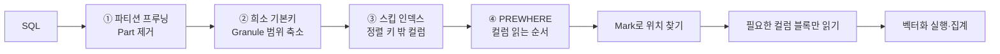
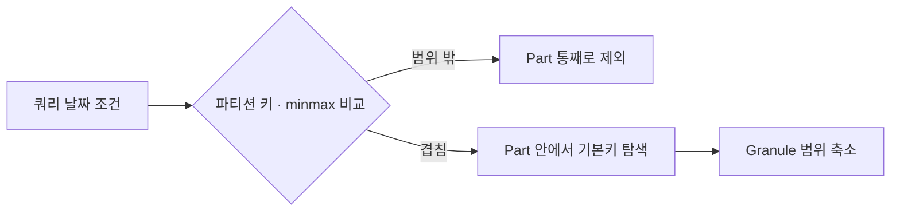
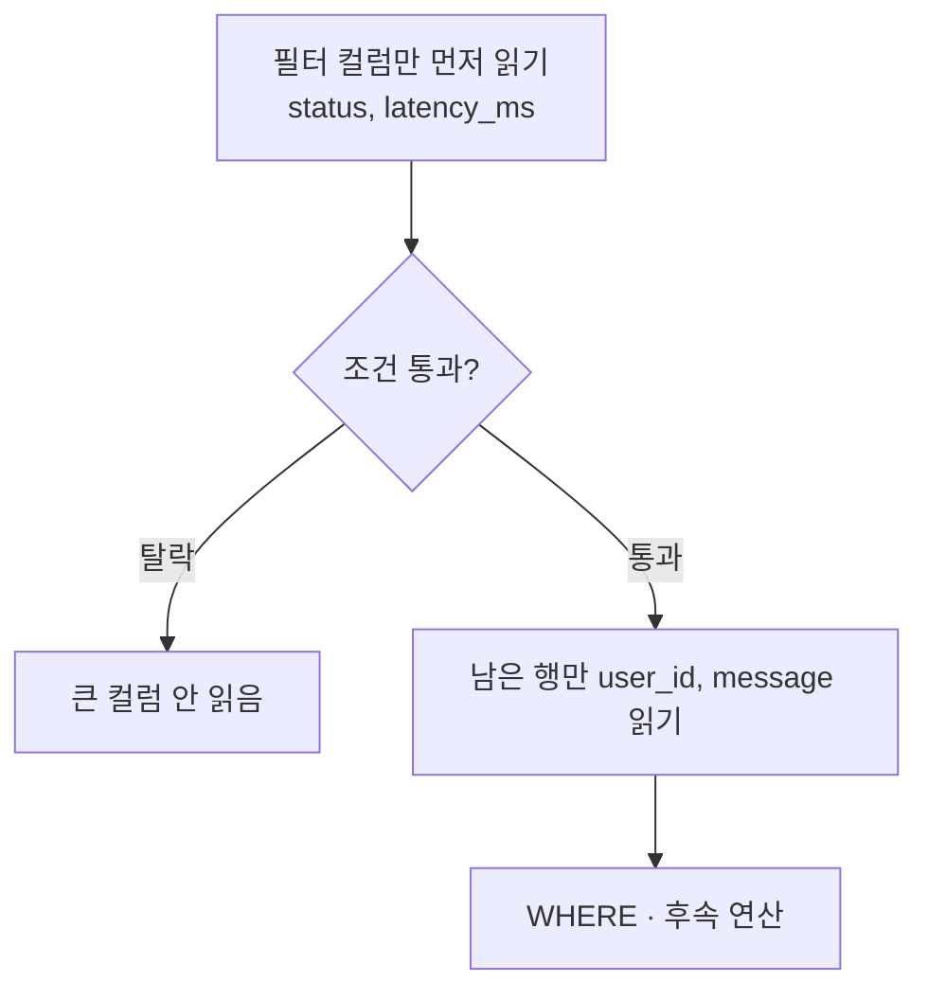
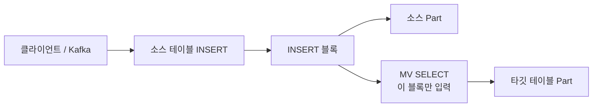
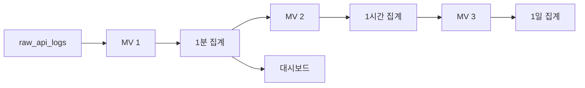

『Learn ClickHouse 마스터클래스』 7장 성능 최적화와 인덱싱 · 8장 Materialized View 파이프라인을 공부하며 정리한 스터디 자료입니다.
교재 내용을 제 말로 다시 풀어 쓰고, **ClickHouse 25.8 Docker 컨테이너에서 직접 돌려 보며** 확인했습니다. 🔬 표시가 붙은 결과는 모두 실측값이고, 교재와 실제 동작이 다른 부분은 정오표로 모았습니다.

**두 장을 관통하는 한 문장**

> 7장은 "**읽을 때** 얼마나 덜 읽을까"(파티션 → 희소 인덱스 → 스킵 인덱스 → PREWHERE), 8장은 "**쓸 때** 미리 줄여 둘까"(MV가 INSERT 블록을 집계 상태로 바꿔 저장)이다. 둘 다 결국 Granule과 Part를 몇 개 건드리느냐의 문제이고, 둘 다 **EXPLAIN과 실측 없이는 효과를 말할 수 없다.**

---

## 7장. 성능 최적화와 인덱싱

### 7.1 인덱스는 "행 주소록"이 아니라 "범위 필터"



| 단계 | 줄이는 대상 | 근거 |
| --- | --- | --- |
| 파티션 프루닝 | 읽을 **Part** | 파티션 키 + Part별 `minmax_*.idx` |
| 희소 기본키 | Part 안의 **Granule 범위** | `primary.cidx` (정렬 키) |
| 스킵 인덱스 | Granule **묶음** | 정렬 키 밖 컬럼의 요약값 |
| PREWHERE | 남은 범위에서 **어떤 컬럼을 먼저** 읽을지 | 실행 전략 (메타데이터 아님) |

---

### 7.2 희소 기본키 인덱스의 물리 구조

- Part 안의 데이터는 정렬 키 순서로 저장되고, **8,192행(`index_granularity`) 단위 Granule**로 나뉩니다.
- 인덱스는 **Granule마다 1개 엔트리**만 가집니다. "이 행은 어디"가 아니라 "이 조건이면 **어느 Granule 범위**를 읽어야 하나"를 알려 줍니다.


| | 밀집 B-Tree (MySQL InnoDB) | ClickHouse 희소 인덱스 |
| --- | --- | --- |
| 단위 | 행 1개 | Granule (8,192행) |
| 결과 | 특정 행의 위치 | 읽어야 할 범위 |
| 크기 | 행 수에 비례 | Granule 수에 비례 (아주 작음) |
| 강점 | 점 조회 · 행 수정 | 대량 범위 스캔 · 집계 |
| 유일성 | PK = 유일 | **PK ≠ 유일**. 정렬 기준일 뿐 |

#### 🔬 실측: 400만 행 테이블의 실제 Part 파일

```text
checksums.txt  columns.txt  count.txt  partition.dat  minmax_event_time.idx
primary.cidx                         ← 교재의 primary.idx (압축됨)
tenant_id.bin  tenant_id.cmrk2       ← 교재의 .mrk2 (압축됨)
country.bin  country.dict.bin …      ← LowCardinality는 사전 파일이 따로
skp_idx_idx_user.idx  skp_idx_idx_user.cmrk2   ← 스킵 인덱스도 자기 Mark를 가짐
```

| 설정 (25.8 기본값) | 값 | 교재와의 차이 |
| --- | --- | --- |
| `index_granularity` | 8192 | 같음 |
| `index_granularity_bytes` | 10 MiB | ⚠️ 행이 크면 Granule이 8,192행보다 **작아질 수 있음** (적응형) |
| `compress_marks` / `compress_primary_key` | 1 / 1 | 파일 이름이 `.cmrk2`, `primary.cidx` |
| `primary_key_lazy_load` | 1 | 인덱스는 **처음 쓸 때** 메모리에 올라감 |

> 400만 행 → Mark 490개. 인덱스 엔트리가 490개뿐이라 메모리에 쉽게 올라갑니다.

---

### 7.3 Granule을 "구간"으로 판정하기

| 판정 | 의미 | 동작 |
| --- | --- | --- |
| 확실히 거짓 | 이 Granule에는 일치 행이 있을 수 없음 | **건너뜀** |
| 일부 가능 / 불확실 | 일부 행이 맞을 수 있음 | 읽고 행 단위 평가 |
| 범위가 조건과 충돌 없음 | 읽어야 함 | 읽고 행 단위 평가 |

> 핵심은 "**거짓으로 확정할 수 있는 범위를 지우는 것**". 읽기로 한 Granule도 결국 행 단위로 다시 검사합니다.

#### 정렬 키 순서가 전부다

정렬 키 `(tenant_id, event_time, user_id)`라면 앞에서부터 쓰는 조건이 유리합니다.

#### 🔬 실측: 400만 행, 정렬 키 `(tenant_id, event_time, user_id)`, Granule 489개

```sql
EXPLAIN indexes = 1
SELECT country, count() FROM web_events
WHERE tenant_id = 100 AND event_time >= '2024-07-01 03:00:00' AND event_time < '2024-07-01 04:00:00'
GROUP BY country;

EXPLAIN indexes = 1
SELECT count() FROM web_events WHERE user_id = 90001;
```

| 쿼리 | PrimaryKey 단계 | 검색 방식 | 스킵 인덱스 |
| --- | --- | --- | --- |
| `tenant_id = 100 AND event_time 범위` | **1 / 489** | binary search | — |
| `user_id = 90001` (3번째 키만) | **489 / 489** (못 줄임) | generic exclusion search | `idx_user`(bloom_filter) → **9 / 489** |

- 앞 컬럼을 건너뛰면 인덱스는 이분 탐색 대신 **generic exclusion search**로 바뀌고, 이 데이터에서는 하나도 못 줄였습니다.
- 해결책은 3가지: ① 정렬 키 재설계 ② 스킵 인덱스 ③ 다른 정렬의 프로젝션. 각각 쓰기·저장 비용이 다릅니다.

#### 함수 조건과 단조성

#### 🔬 실측: `toDate(event_time) = '2024-07-02'`도 인덱스를 쓸까?

```sql
EXPLAIN indexes = 1 SELECT count() FROM t2 WHERE toDate(event_time) = '2024-07-02';
--   PrimaryKey
--     Condition: (toDate(event_time) in [19906, 19906])
--     Granules: 2/122
--     Search Algorithm: binary search
```

- `toDate`가 **단조 함수**라서 인덱스가 범위로 해석합니다(2/122).
- ⚠️ 교재는 "`EXPLAIN SYNTAX`로 이 변환을 확인하라"고 하지만, 25.8에서는 `EXPLAIN SYNTAX`에도 `EXPLAIN QUERY TREE`에도 `toDate(event_time) = …`가 **그대로** 나옵니다. 인덱스가 실제로 쓰였는지는 **`EXPLAIN indexes = 1`의 PrimaryKey Condition과 Granules**로 봐야 합니다.

---

### 7.4 파티션 프루닝



#### 🔬 실측: 12개월 × 1 Part, 3월만 조회

```sql
EXPLAIN indexes = 1
SELECT count() FROM pm WHERE event_time >= '2024-03-01' AND event_time < '2024-04-01' AND v = 1;
--   MinMax     Parts: 1/12   Granules: 11/124
--   Partition  Parts: 1/1    Granules: 11/11
--   PrimaryKey Parts: 1/1    Granules: 11/11
```

- 12개 Part 중 11개를 **열어 보지도 않고** 제외했습니다. 그 뒤에 기본키가 남은 Part 안을 줄입니다.

#### 파티션 키 설계

| 설계 | 문제 |
| --- | --- |
| `PARTITION BY toYYYYMMDD(...)` (일 단위, 장기 보존) | Active Part·메타데이터 폭증, Merge 대상 분산 |
| `PARTITION BY user_id` | INSERT 한 번에 파티션 수백 개 → `max_partitions_per_insert_block`(기본 **100**) 초과로 바로 에러 |
| 권장 출발점 | 시계열은 월 단위, 활성 파티션 수십~수백 개 (교재 경험치) |

---

### 7.5 데이터 스킵 인덱스

- 정렬 키에 없는 컬럼용. **`GRANULARITY N`개 Granule을 묶어** 요약값을 저장하고, 조건상 불가능한 묶음을 건너뜁니다.
- `GRANULARITY`가 작으면 세밀하지만 인덱스가 커지고, 크면 작지만 한 묶음에 값이 섞여 효과가 떨어집니다.

| 타입 | 요약 구조 | 적합 | 주의 |
| --- | --- | --- | --- |
| `minmax` | 묶음의 최소·최대 | 정렬 키와 상관있는 수치·날짜 | 값이 무작위면 효과 없음 |
| `set(N)` | 묶음의 고유값 집합 | 저카디널리티 (상태 코드) | 값이 **모든 묶음에 골고루** 있으면 효과 없음 |
| `bloom_filter(p)` | 해시 비트 배열 | 고카디널리티 등가 (UUID, user_id) | 거짓 양성, 범위 조건 불가 |
| `tokenbf_v1` | 토큰 단위 블룸 | 로그의 **단어** 검색 | 토큰 경계가 맞아야 함 |
| `ngrambf_v1` | N-gram 블룸 | `LIKE '%부분문자열%'` | 검색어가 N보다 짧으면 안 씀 |

> 25.8에는 이 5개 말고도 `text`(전문 검색, 실험 기능 — `allow_experimental_full_text_index` 필요), `vector_similarity` 등이 있습니다. 교재의 "다섯 가지"는 고전적인 범위입니다.

#### 🔬 실측: 스킵 인덱스가 실제로 줄인 Granule (전체 489)

| 조건 | 인덱스 | 결과 | 해석 |
| --- | --- | --- | --- |
| `user_id = 90001` | bloom_filter | **9 / 489** | 고카디널리티 등가 → 잘 맞음 |
| `url LIKE '%checkout%'` | ngrambf_v1(4,…) | **3 / 489** | 부분 문자열 → 잘 맞음 |
| `message LIKE '%timeout%'` | tokenbf_v1 | **489 / 489** ❌ | 와일드카드에 붙은 문자열은 완전한 토큰으로 안 봄 |
| `hasToken(message, 'timeout')` | tokenbf_v1 | **3 / 489** ✅ | 토큰 함수로 물어야 인덱스를 씀 |
| `status = 500` | set(100) | **489 / 489** ❌ | 500이 97행마다 1번씩 → 모든 묶음에 존재 |

> ⚠️ 교재는 tokenbf_v1 예시에 `LIKE '%timeout%'`를 쓰지만, 25.8에서는 이 형태로 **인덱스가 하나도 줄이지 못했습니다.** `hasToken`으로 바꾸면 3개만 읽습니다.
> ⚠️ `set` 인덱스는 "값의 종류가 적다"만으로는 부족하고, **값이 특정 묶음에 몰려 있어야** 건너뛸 수 있습니다.

---

### 7.6 프로젝션: 같은 테이블에 다른 정렬 경로 하나 더

- 원본과 **다른 정렬 순서 / 집계 형태**의 데이터를 Part 안에 같이 저장. 옵티마이저가 더 적게 읽는 쪽을 고릅니다.
- `ADD PROJECTION`은 정의만 추가 → 과거 Part에는 `MATERIALIZE PROJECTION`을 따로 돌려야 합니다.

#### 🔬 실측: MATERIALIZE 전후

```sql
ALTER TABLE pj ADD PROJECTION p_u (SELECT * ORDER BY u);
EXPLAIN projections = 1, indexes = 1 SELECT count() FROM pj WHERE u = 5;
--   ReadFromMergeTree (s7.pj)   Granules: 12/12      ← 정의만 있으면 원본 경로

ALTER TABLE pj MATERIALIZE PROJECTION p_u SETTINGS mutations_sync = 1;
EXPLAIN projections = 1, indexes = 1 SELECT count() FROM pj WHERE u = 5;
--   ReadFromMergeTree (p_u)     Granules: 1/12       ← 프로젝션 경로
```

#### 🔬 실측: 프로젝션이 있으면 DELETE가 막힌다 (교재에 없는 운영 제약)

```sql
DELETE FROM pj WHERE k = 1;
-- ❌ Code: 344. DELETE query is not allowed for table s7.pj because as it has projections
--    and setting lightweight_mutation_projection_mode is set to THROW.
```

| 프로젝션 비용 | |
| --- | --- |
| 저장 | `SELECT *` 프로젝션이면 약 2배 |
| 쓰기 · Merge | 새 Part · Merge마다 프로젝션도 같이 |
| 운영 제약 | Lightweight DELETE/UPDATE 기본 거부 (`lightweight_mutation_projection_mode = throw`), Replacing 계열은 `deduplicate_merge_projection_mode = throw` |
| 25.8 대안 | `SELECT _part_offset ORDER BY u` 형태의 **가벼운(인덱스형) 프로젝션** — 25.8에서 생성 확인 |

> 프로젝션은 "인덱스 하나 더"가 아니라 **테이블을 하나 더 들고 다니는 결정**입니다.

---

### 7.7 PREWHERE와 컬럼별 순차 평가



#### 🔬 실측: 직접 안 써도 PREWHERE로 옮겨진다

```sql
EXPLAIN actions = 1
SELECT user_id, message FROM web_events WHERE status = 500 AND latency_ms > 900;
--   ReadFromMergeTree (s7.web_events)
--   Prewhere info
--     Prewhere filter column: and(equals(status, 500), greater(latency_ms, 900))
```

| 설정 (25.8 기본값) | 값 | 의미 |
| --- | --- | --- |
| `optimize_move_to_prewhere` | **1** | ⚠️ 교재는 "켜면"이라고 쓰지만 **이미 기본으로 켜져 있음** |
| `move_all_conditions_to_prewhere` | 1 | 가능한 조건은 전부 PREWHERE로 |
| `enable_multiple_prewhere_read_steps` | 1 | 교재 7.7.3의 "컬럼별 순차 평가"가 이것 |
| `allow_reorder_prewhere_conditions` | 1 | 조건 순서를 비용 기준으로 재배치 |

> PREWHERE는 메타데이터로 블록을 건너뛰는 **스킵 인덱스와 다릅니다.** 이미 후보가 된 범위 안에서 "어떤 컬럼을 먼저 읽을지"를 정하는 실행 전략입니다.

---

### 7.8 EXPLAIN으로 검증하기

| 모드 | 보는 것 | 25.8 실측 메모 |
| --- | --- | --- |
| `EXPLAIN AST` | 파싱 결과 | 실행 계획 아님 |
| `EXPLAIN SYNTAX` | 재작성된 SQL | ⚠️ Analyzer 최적화가 **거의 안 보임** |
| `EXPLAIN QUERY TREE dump_ast = 1` | Analyzer 쿼리 트리 | 상수 폴딩·preimage 변환 확인용 (3장 실측) |
| `EXPLAIN indexes = 1` | MinMax · Partition · PrimaryKey · Skip 단계별 **Parts a/b, Granules c/d** | **인덱스 검증은 여기서** |
| `EXPLAIN projections = 1` | 프로젝션 선택 여부 | 교재에 없는 옵션 |
| `EXPLAIN PIPELINE` | Processor 연결 · 병렬 레인 | 아래 참고 |
| `EXPLAIN ESTIMATE` | 읽을 parts / rows / marks 추정 | `tenant_id = 100` → parts 1, rows 16,384, marks 2 |

#### 🔬 실측: EXPLAIN PIPELINE (20코어)

```text
(Expression)
ExpressionTransform × 20
  (Aggregating)
  Resize 20 → 20
    AggregatingTransform × 20
      (Expression)
      ExpressionTransform × 20
        (ReadFromMergeTree)
        MergeTreeSelect(pool: ReadPool, algorithm: Thread) × 20 0 → 1
```

> ⚠️ 교재는 확인 항목으로 "Resize, Repartition, Exchange"를 듭니다. 25.8 출력에는 `Resize`는 있지만 **Repartition·Exchange라는 Processor는 없습니다** (다른 엔진의 용어로 보입니다). 교재의 "Selected Marks: X of Y"도 EXPLAIN 출력이 아니라, 실제로는 `Granules: 1/489` 형식으로 나옵니다.

> 💡 측정할 때: 25.8은 `use_query_condition_cache = 1`이 기본이라, 같은 조건을 반복 실행하면 두 번째부터 읽는 양이 줄어 보일 수 있습니다. 비교 실험은 `SET use_query_condition_cache = 0`으로.

---

## 8장. Materialized View 파이프라인

### 8.1 MV는 "저장된 SELECT"가 아니라 "INSERT에 붙은 트리거"



| 다른 DB의 MV | ClickHouse MV |
| --- | --- |
| 결과를 저장해 두고 **주기적으로 재계산** | 소스에 **INSERT가 들어올 때마다** 그 블록만 변환해 타깃에 INSERT |
| 소스 전체를 다시 읽음 | **방금 들어온 블록만** 읽음 |
| 과거 데이터도 반영 | MV 생성 **이전** 데이터는 자동 반영 안 됨 |

- MV의 GROUP BY는 **그 블록 안에서만** 집계됩니다. 그래서 타깃에는 같은 키의 **부분 결과가 여러 행** 생깁니다 → 타깃 엔진(Summing/Aggregating)이 Merge 때 합쳐야 합니다.
- MV의 CPU·메모리 비용은 **INSERT 지연시간에 그대로 더해집니다.**

---

### 8.2 실패 전파: "원자적 체인"인가?

#### 🔬 실측: MV가 실패하면 소스는?

```sql
CREATE TABLE src (x Int32) ENGINE = MergeTree ORDER BY x;
CREATE TABLE dst (y Int32) ENGINE = MergeTree ORDER BY y;
CREATE MATERIALIZED VIEW mv_fail TO dst AS SELECT throwIf(x = 42, 'boom') + x AS y FROM src;

INSERT INTO src VALUES (1), (42);
-- ❌ Code: 395. boom … while pushing to view s8.mv_fail
SELECT count() FROM src;   -- 2   ← 소스에는 이미 들어감!
SELECT count() FROM dst;   -- 0
```

> ⚠️ 클라이언트는 **에러**를 받았지만 소스에는 2행이 **커밋돼 있습니다.** 롤백되는 원자성이 아닙니다. 이 상태에서 클라이언트가 재시도하면 소스에 **중복**이 생깁니다. 교재가 말하는 "원자적 체인"은 "하류 실패가 상류 INSERT의 응답을 실패로 만든다"까지만 맞습니다.

| 관련 설정 (25.8 기본값) | 값 | 의미 |
| --- | --- | --- |
| `materialized_views_ignore_errors` | 0 | MV 에러를 INSERT 에러로 전파 |
| `parallel_view_processing` | 0 | 여러 MV를 순차로 실행 |
| `deduplicate_blocks_in_dependent_materialized_views` | 0 | 재시도 시 MV 타깃 쪽 중복 제거 꺼짐 |

---

### 8.3 명시적 타깃 테이블 (`TO`) 패턴

| 구성 요소 | 책임 |
| --- | --- |
| 소스 테이블 | 원시 데이터 보존 · 재처리 기준 |
| 타깃 테이블 | 집계 결과 저장 · 파티션 · 정렬 키 · TTL |
| MV | INSERT 블록 변환과 라우팅만 |

- 타깃을 MV 안에 자동 생성(`.inner_id.<uuid>`)하면 스키마 변경·백업·파티션 조작·백필이 불편 → 교재는 **프로덕션 안티패턴**으로 분류.

#### 🔬 실측: 교재 8.3.1 예시는 그대로는 안 만들어진다

```sql
CREATE MATERIALIZED VIEW mv_inner ENGINE = SummingMergeTree() AS SELECT …;
-- ❌ Code: 42. ORDER BY or PRIMARY KEY clause is missing.
```

> 자동 생성 방식이라도 `ENGINE = SummingMergeTree ORDER BY (...)`처럼 정렬 키는 있어야 합니다. (예시의 `count() AS user_count`도 고유 사용자 수가 아니라 **이벤트 수**입니다.)

---

### 8.4 ~ 8.5 AggregatingMergeTree로 실시간 집계 큐브

- 고유 사용자 수·p95는 **더할 수 없습니다.** (블록1 UV 100 + 블록2 UV 120 ≠ 전체 UV. p95의 평균 ≠ 전체 p95)
- 그래서 최종 숫자 대신 **합칠 수 있는 중간 상태**를 저장합니다.


| 저장 (MV) | 타깃 컬럼 타입 | 조회 |
| --- | --- | --- |
| `uniqExactState(user_id)` | `AggregateFunction(uniqExact, UInt64)` | `uniqExactMerge(col)` |
| `quantileState(0.95)(latency)` | `AggregateFunction(quantile(0.95), Float32)` | `quantileMerge(0.95)(col)` |
| 단순 합계 | **`SimpleAggregateFunction(sum, UInt64)`** | `sum(col)` |

| 정확 vs 근사 | |
| --- | --- |
| `uniqExact` | 정확. 상태 크기가 고유값 수만큼 커짐 |
| `uniq` | 근사. 상태가 작고 결합이 빠름 |
| `quantile` | **근사** (리저버 샘플링). 정확값은 `quantileExact` |

#### 🔬 실측 ⚠️: 교재 DDL의 `total_requests UInt64`는 Merge 후 틀어진다

교재의 1분 집계 테이블은 `total_requests UInt64`, `error_count UInt64`를 **일반 컬럼**으로 선언합니다. AggregatingMergeTree는 Merge 때 `AggregateFunction`/`SimpleAggregateFunction` 컬럼만 합치고, 일반 컬럼은 **한 행의 값만 남깁니다.**

```sql
-- 교재와 같은 구조의 타깃 + MV
-- INSERT 1: 같은 분 · 같은 테넌트 10건 (전부 200)
-- INSERT 2: 같은 분 · 같은 테넌트 5건 (전부 500)
-- 원시 데이터 정답: 요청 15건, 에러 5건, UV 10

SELECT sum(total_requests), sum(error_count), uniqExactMerge(unique_users) FROM agg1m;
```

| 시점 | total_requests | error_count | UV |
| --- | --- | --- | --- |
| Merge 전 (Part 2개) | 15 ✅ | 5 ✅ | 10 ✅ |
| `OPTIMIZE FINAL` 후 | **10 ❌** | **0 ❌** | 10 ✅ |

```sql
-- 고친 버전
CREATE TABLE agg_ok (minute_bucket DateTime, total_requests SimpleAggregateFunction(sum, UInt64))
ENGINE = AggregatingMergeTree ORDER BY minute_bucket;
-- 10, 5를 따로 INSERT → OPTIMIZE FINAL → 15 ✅
```

> 📌 이 버그는 **Merge 전에는 숫자가 맞기 때문에** 개발 중에는 안 보이고, 백그라운드 Merge가 돈 뒤에야 대시보드 숫자가 줄어듭니다. 교재 8.10.3의 "원시 vs 집계 비교" 검증도 Merge 타이밍에 따라 통과했다가 실패합니다.

---

### 8.6 다단계 연쇄 MV



- 다음 단계는 이미 만들어진 **상태를 합쳐서 다시 상태로**: `uniqExactMergeState(col)`, `quantileMergeState(0.95)(col)`.
- 흔한 실수: 상태 컬럼에 다시 `-State`를 거는 것.
- 체인 길이 = INSERT 하나가 거치는 변환·쓰기 단계 수. 교재 권장은 **2~3단계 이내** (저자 지침, 공식 기준은 아님).

#### 🔬 실측: 1분 테이블에 직접 백필하면 1시간 테이블에도 흘러간다

```sql
CREATE TABLE l1 (h DateTime, c UInt64) ENGINE = SummingMergeTree ORDER BY h;
CREATE TABLE l2 (d Date, c UInt64) ENGINE = SummingMergeTree ORDER BY d;
CREATE MATERIALIZED VIEW mv_l2 TO l2 AS SELECT toDate(h) AS d, sum(c) AS c FROM l1 GROUP BY d;

INSERT INTO l1 VALUES ('2024-01-01 01:00:00', 7);   -- MV를 거치지 않은 "직접 백필"
SELECT sum(c) FROM l2;                               -- 7
```

> 연쇄 MV는 **중간 테이블에 들어오는 모든 INSERT**에 반응합니다(Merge에는 반응 안 함). 1분 테이블을 백필하면 1시간 테이블도 자동으로 채워지므로, 1시간 테이블을 **따로 또 백필하면 두 번 들어갑니다.**

---

### 8.7 과거 데이터 백필

| 데이터 | MV 동작 |
| --- | --- |
| MV 생성 이후 INSERT | 자동 변환 |
| MV 생성 이전 데이터 | **자동 반영 안 됨** |
| 소스에서 읽어 타깃에 `INSERT … SELECT` | 명시적 백필 |

#### 🔬 실측: POPULATE

```sql
CREATE MATERIALIZED VIEW mv_pop TO tgt POPULATE AS SELECT …;
-- ❌ Code: 62. When creating a materialized view you can't declare both 'TO [db].[table]' and 'POPULATE'.
```

```sql
SELECT 1 SETTINGS materialized_views_populate_atomically = 1;
-- ❌ Code: 115. Setting materialized_views_populate_atomically is neither a builtin setting …
```

> ⚠️ 교재 8.7.2의 `TO … POPULATE` 예시는 25.8에서 **문법 에러**이고, 교재가 언급한 `materialized_views_populate_atomically` 설정은 25.8에 **없습니다** (교재가 함께 기준으로 삼은 26.x 이후 기능일 수 있음). 25.8에서 POPULATE는 내부 테이블 방식에서만 가능하고, POPULATE 도중 들어온 INSERT는 빠질 수 있습니다. → 교재 결론과 같이 **운영 백필은 수동 `INSERT … SELECT`가 기본**입니다.

#### 무중단 백필 순서

1. 타깃 테이블을 빈 상태로 만든다.
2. 신규 INSERT용 MV를 만든다 (이 시점부터 실시간 반영).
3. MV 생성 **이전** 구간만, 월·일 단위로 나눠 타깃에 직접 `INSERT … SELECT` (상태 함수 그대로).
4. 경계 구간의 중복·누락을 원시 테이블과 비교해 검증한다.

- 기간을 쪼개면 메모리·실행 시간·재시작 범위를 통제하기 쉽지만, **배치 수만큼 Part가 생기는 건 그대로**입니다.

#### 🔬 실측: ATTACH PARTITION FROM은 "교체"가 아니라 "추가"

```sql
CREATE TABLE a (d Date, v UInt64) ENGINE = MergeTree PARTITION BY toYYYYMM(d) ORDER BY d;
CREATE TABLE b AS a;
INSERT INTO a VALUES ('2024-01-05', 1);
INSERT INTO b VALUES ('2024-01-05', 100);

ALTER TABLE a ATTACH PARTITION '202401' FROM b;
SELECT groupArray(v) FROM a;   -- [100, 1]   ← 기존 데이터에 "추가"됨 (중복 위험)
SELECT count() FROM b;         -- 1          ← 원본도 그대로 (하드링크 복사)

ALTER TABLE a REPLACE PARTITION 202401 FROM b;
SELECT groupArray(v) FROM a;   -- [100]      ← 진짜 교체는 REPLACE PARTITION
```

> ⚠️ 교재는 스테이징 + `ATTACH PARTITION`을 "O(1) 무중단 교체 패턴"으로 소개하지만, 타깃에 같은 파티션이 이미 있으면 **합쳐집니다.** 교체가 목적이면 `REPLACE PARTITION`을 써야 합니다. (하드링크라 빠르다는 점은 맞습니다.)

---

### 8.8 MV 안의 JOIN: 시점이 고정된다

#### 🔬 실측: 오른쪽 테이블이 바뀌면?

```sql
CREATE MATERIALIZED VIEW mv_j TO seg_cnt AS
SELECT u.seg AS seg, count() AS c FROM ev AS e JOIN users AS u ON e.user_id = u.user_id GROUP BY seg;

INSERT INTO users VALUES (1, 'gold');
INSERT INTO ev VALUES (1);          -- MV 실행 → ('gold', 1)
INSERT INTO users VALUES (2, 'silver');  -- users INSERT는 MV를 실행하지 않음
INSERT INTO ev VALUES (3);          -- user 3은 users에 없음 → INNER JOIN에서 탈락
SELECT groupArray((seg, c)) FROM seg_cnt;   -- [('gold', 1)]
```

- MV는 **FROM의 가장 왼쪽 테이블**(`ev`) INSERT에만 반응합니다. `users`가 바뀌어도 아무 일도 안 일어나고, 이미 쌓인 결과도 다시 계산되지 않습니다.
- INNER JOIN이라 아직 `users`에 없는 사용자의 이벤트는 **조용히 사라집니다.**
- INSERT 블록마다 오른쪽 테이블로 해시 테이블을 만들 수 있으므로, `users`가 크면 INSERT 지연이 커집니다 → Dictionary 대안 검토.

---

### 8.9 고카디널리티 GROUP BY 함정

- MV는 "원시보다 작게 줄이려고" 쓰는데, `request_id`·나노초 시각처럼 거의 행마다 다른 키로 묶으면 **원시와 같은 행 수 + MV 비용**만 남습니다.
- 집계 차원은 실제 조회 패턴(분·시간·일 × 테넌트·엔드포인트·상태 코드)에 맞춥니다.
- 참고: 교재 예시의 `toStartOfNanosecond`는 25.8에 있지만, `DateTime64(3)` 입력에서는 아무것도 자르지 않습니다(밀리초 이하가 원래 0).

---

### 8.10 실전 레시피: 함수 대응표와 검증

| 저장 (MV / 백필) | 다음 단계 (연쇄) | 최종 조회 |
| --- | --- | --- |
| `sumState` | `sumMergeState` | `sumMerge` |
| `uniqState` | `uniqMergeState` | `uniqMerge` |
| `uniqExactState` | `uniqExactMergeState` | `uniqExactMerge` |
| `quantileState(0.95)` | `quantileMergeState(0.95)` | `quantileMerge(0.95)` |
| 단순 합계 → `SimpleAggregateFunction(sum, T)` | `sum` | `sum` |

배포 전 검증: 같은 시간 범위에서 원시 테이블 `count()`, `uniqExact()` ↔ 집계 테이블 `sum()`, `uniqExactMerge()` 비교. **반드시 `OPTIMIZE … FINAL` 이후에도** 비교할 것 (위 8.4 함정 때문).

---

## 📌 교재 vs 실제 (25.8) 정오표

| 교재 내용 | 실제 확인 결과 |
| --- | --- |
| `primary.idx`, `.mrk2` | `primary.cidx`, `.cmrk2` (압축이 기본) |
| Granule = 8,192행 | `index_granularity_bytes`(10 MiB) 때문에 행이 크면 더 작아짐 |
| `EXPLAIN SYNTAX`로 단조 함수 변환 확인 | 변환이 안 보임. **`EXPLAIN indexes = 1`의 Condition·Granules**로 확인 |
| tokenbf_v1 + `LIKE '%timeout%'` | **489/489, 인덱스 효과 없음.** `hasToken`이면 3/489 |
| 스킵 인덱스 다섯 가지 | 25.8에 `text`(실험), `vector_similarity` 등 추가 |
| 프로젝션 비용 = 저장·쓰기·Merge | + **Lightweight DELETE/UPDATE 기본 거부** |
| `optimize_move_to_prewhere = 1`을 쓰면 | **이미 기본값 1** |
| "Selected Marks: X of Y" | 25.8 출력은 `Granules: a/b` |
| PIPELINE의 Repartition · Exchange | 25.8 출력에 없음 (`Resize`는 있음) |
| MV = 원자적 체인 | MV 실패 시 클라이언트는 에러, **소스는 이미 커밋** (부분 성공) |
| `ENGINE = SummingMergeTree()` 내부 테이블 MV | ORDER BY 없어서 **에러** |
| AggregatingMergeTree에 `total_requests UInt64` | Merge 후 **15 → 10, 5 → 0**. `SimpleAggregateFunction(sum, …)` 필요 |
| `TO … POPULATE` | **문법 에러** (함께 못 씀) |
| `materialized_views_populate_atomically` | 25.8에 **없는 설정** |
| ATTACH PARTITION = O(1) 무중단 교체 | 같은 파티션이 있으면 **추가(중복)**. 교체는 `REPLACE PARTITION` |
| 연쇄 MV 중간 테이블 직접 백필 | 하류 MV로 **자동 전파** → 하류를 또 백필하면 중복 |

---

## 🧩 퀴즈

**Q1.** 정렬 키가 `(tenant_id, event_time, user_id)`인 테이블에서 `WHERE user_id = 90001`만 걸면 PrimaryKey 단계의 검색 방식과 결과는?

**Q2.** 파티션 프루닝, 희소 기본키, 스킵 인덱스, PREWHERE를 "줄이는 대상" 기준으로 큰 것부터 나열하면?

**Q3.** `INDEX idx_msg message TYPE tokenbf_v1(1024, 3, 0)`이 있을 때 `WHERE message LIKE '%timeout%'`과 `WHERE hasToken(message, 'timeout')` 중 인덱스를 쓰는 쪽은?

**Q4.** 상태 코드 컬럼에 `set(100)` 인덱스를 걸었는데 `status = 500` 조건에서 하나도 못 건너뛰었다. 왜일까?

**Q5.** `ADD PROJECTION`만 하고 `MATERIALIZE PROJECTION`을 안 하면 기존 데이터 조회는 어느 경로로 갈까?

**Q6.** 프로젝션이 있는 테이블에 `DELETE FROM t WHERE …`를 실행하면 25.8 기본 설정에서 어떻게 될까?

**Q7.** 소스 테이블에 MV가 붙어 있고, MV SELECT가 특정 행에서 예외를 던졌다. 클라이언트는 에러를 받았다. 소스 테이블에는 데이터가 들어갔을까?

**Q8.** AggregatingMergeTree 타깃에 `total_requests UInt64`(일반 컬럼)로 저장했다. 10건, 5건을 같은 키로 두 번 INSERT하고 `OPTIMIZE FINAL` 후 `sum(total_requests)`는?

**Q9.** 1분 집계 → 1시간 집계 연쇄 MV에서, 1분 테이블에 과거 데이터를 직접 `INSERT … SELECT`로 백필했다. 1시간 테이블도 따로 백필해야 할까?

**Q10.** 스테이징 테이블의 202401 파티션을 `ATTACH PARTITION '202401' FROM staging`으로 붙였는데, 타깃에 이미 202401 데이터가 있었다면?

**Q11.** MV 안에서 `users` 테이블과 JOIN해 세그먼트별로 집계한다. 나중에 `users.segment`를 바꾸면 과거 집계는?

---

<details markdown="1">
<summary><b>정답 보기</b></summary>


1. **generic exclusion search, 489/489 Granule (못 줄임).** 앞 컬럼을 건너뛰었기 때문입니다. 실측에서는 `user_id`에 건 bloom_filter 스킵 인덱스가 9/489로 줄였습니다.
2. **파티션 프루닝(Part) → 희소 기본키(Granule 범위) → 스킵 인덱스(Granule 묶음) → PREWHERE(남은 범위의 컬럼 읽는 순서).**
3. **`hasToken`.** 실측에서 `LIKE '%timeout%'`은 489/489, `hasToken`은 3/489였습니다.
4. 값 500이 **모든 Granule 묶음에 골고루** 있기 때문입니다. set 인덱스는 값이 특정 묶음에 몰려 있어야 효과가 있습니다.
5. **원본 경로.** 실측에서 MATERIALIZE 전 12/12(원본), 후 1/12(프로젝션 `p_u`).
6. **에러.** `lightweight_mutation_projection_mode = throw`가 기본이라 DELETE가 거부됩니다.
7. **들어갔다.** MV 실패는 롤백이 아닙니다. 재시도하면 소스에 중복이 생길 수 있습니다.
8. **10 (또는 5).** 일반 컬럼은 Merge 때 합쳐지지 않고 한 행 값만 남습니다. `SimpleAggregateFunction(sum, UInt64)`로 선언해야 15가 됩니다.
9. **하면 안 된다.** 1분 테이블 INSERT가 1시간 MV를 실행시켜 자동으로 전파됩니다. 또 백필하면 두 번 들어갑니다.
10. **기존 데이터에 추가되어 중복이 생깁니다.** 교체하려면 `REPLACE PARTITION`.
11. **그대로다.** MV는 왼쪽 테이블 INSERT 시점의 `users` 값으로 계산했고, `users` 변경에는 반응하지 않습니다. 재계산하려면 별도 백필 절차가 필요합니다.

</details>

---

## 🔑 키워드 심화: AggregatingMergeTree의 일반 컬럼 함정

**왜 필요한가?** MV + AggregatingMergeTree는 ClickHouse 실시간 집계의 표준 패턴입니다. 그런데 교재 예제처럼 "합계는 그냥 UInt64로 두고 sum으로 조회"하면, **Merge 전에는 맞고 Merge 후에 틀리는** 가장 찾기 어려운 종류의 버그가 생깁니다.

**내부적으로 어떻게 동작하나?**

- MV는 INSERT 블록마다 부분 결과를 만든다 → 같은 `(tenant, endpoint, minute)` 키가 여러 Part에 여러 행으로 존재
- Merge는 같은 정렬 키 행들을 한 행으로 만든다
  - `AggregateFunction` 컬럼 → 상태를 결합 (uniq, quantile 등)
  - `SimpleAggregateFunction(f, T)` 컬럼 → `f`로 결합 (sum, max, min, any…)
  - **그 밖의 일반 컬럼 → 결합 규칙이 없으니 한 행의 값만 남김**
- 🔬 실측: 15/5 → Merge 후 10/0

**운영에서 어떤 문제가 생기나?** (토론)

- 개발·QA 환경은 데이터가 적어 Merge가 늦게 돈다 → 테스트는 통과, 운영에서만 숫자가 줄어든다. 어떻게 테스트해야 할까? (`OPTIMIZE FINAL` 후 검증)
- 이미 잘못된 스키마로 운영 중이라면? 타입 변경(`MODIFY COLUMN … SimpleAggregateFunction`)만으로 과거 데이터가 복구될까?
- SummingMergeTree를 쓰면 이 문제가 없을까? 대신 무엇을 잃을까? (uniq·분위수 상태)
- `SimpleAggregateFunction(sum, …)` vs `AggregateFunction(sum, …)`: 저장 크기와 조회 문법 차이는?

---

## 💬 토론 질문

**왜 그렇게 동작할까?**

- 희소 인덱스가 행이 아니라 Granule을 가리키는 설계는 점 조회에서 무엇을 포기한 걸까?
- tokenbf_v1이 `LIKE '%timeout%'`을 못 쓰는 이유는? (힌트: `%` 앞뒤 문자열이 "완전한 토큰"인지 알 수 없음)
- MV가 실패해도 소스를 롤백하지 않는 설계는 어떤 장점이 있을까?

**다른 방식이라면?**

- 정렬 키 재설계 · 스킵 인덱스 · 프로젝션 중 `user_id` 단독 조회를 빠르게 하는 방법을 고른다면? 쓰기 비용은?
- MV 대신 Refreshable MV(주기적 재계산)를 쓰면 8.8의 JOIN 시점 문제는 해결될까?

**실제 운영에서도 그럴까?**

- 같은 조건 쿼리를 반복 벤치마크하면 `use_query_condition_cache`가 숫자를 어떻게 왜곡할까?
- MV가 5개 붙은 테이블에 초당 수천 건 INSERT가 들어오면 INSERT 지연은 어떻게 될까? (`parallel_view_processing`)
- MV 체인 중간 단계가 실패해서 재시도했다면, 어느 테이블에 중복이 생길까?

---

## 🧪 실습 (직접 재현)

```bash
docker run -d --name ch-study --ulimit nofile=262144:262144 \
  -e CLICKHOUSE_SKIP_USER_SETUP=1 clickhouse/clickhouse-server:25.8
docker exec -it ch-study clickhouse-client
```

```sql
SET use_query_condition_cache = 0;

-- 1) 인덱스 실험 테이블 (400만 행)
CREATE TABLE web_events
(
    tenant_id UInt32, event_time DateTime64(3), user_id UInt64, status UInt16,
    country LowCardinality(String), url String, latency_ms UInt32, message String,
    INDEX idx_status status TYPE set(100) GRANULARITY 2,
    INDEX idx_user user_id TYPE bloom_filter(0.01) GRANULARITY 1,
    INDEX idx_url url TYPE ngrambf_v1(4, 256, 2, 0) GRANULARITY 1,
    INDEX idx_msg message TYPE tokenbf_v1(1024, 3, 0) GRANULARITY 1
)
ENGINE = MergeTree PARTITION BY toYYYYMM(event_time) ORDER BY (tenant_id, event_time, user_id);

INSERT INTO web_events SELECT
  number % 200,
  toDateTime64('2024-07-01 00:00:00', 3) + intDiv(number, 200) * 3,
  cityHash64(number) % 1000000,
  if(number % 97 = 0, 500, 200),
  ['KR', 'US', 'JP', 'DE'][number % 4 + 1],
  concat('https://ex.com/', if(number % 5000 = 0, 'checkout', 'page'), '/', toString(number % 50)),
  number % 1000,
  if(number % 10000 = 0, 'upstream timeout occurred', 'request ok')
FROM numbers(4000000);
OPTIMIZE TABLE web_events FINAL;

EXPLAIN indexes = 1 SELECT count() FROM web_events WHERE tenant_id = 100 AND event_time >= '2024-07-01 03:00:00' AND event_time < '2024-07-01 04:00:00';
EXPLAIN indexes = 1 SELECT count() FROM web_events WHERE user_id = 90001;
EXPLAIN indexes = 1 SELECT count() FROM web_events WHERE message LIKE '%timeout%';
EXPLAIN indexes = 1 SELECT count() FROM web_events WHERE hasToken(message, 'timeout');
EXPLAIN indexes = 1 SELECT count() FROM web_events WHERE status = 500;
EXPLAIN actions = 1 SELECT user_id, message FROM web_events WHERE status = 500 AND latency_ms > 900;
-- 도전: status를 if(intDiv(number, 100000) = 7, 500, 200)처럼 한 구간에 몰리게 넣으면 set 인덱스 결과는?

-- 2) AggregatingMergeTree 일반 컬럼 함정
CREATE TABLE raw (event_time DateTime64(3, 'UTC'), tenant_id UInt32, endpoint LowCardinality(String),
                  user_id UInt64, latency_ms Float32, http_status UInt16)
ENGINE = MergeTree ORDER BY (tenant_id, event_time);
CREATE TABLE agg1m (minute_bucket DateTime, tenant_id UInt32, endpoint LowCardinality(String),
                    total_requests UInt64, error_count UInt64,
                    unique_users AggregateFunction(uniqExact, UInt64))
ENGINE = AggregatingMergeTree ORDER BY (tenant_id, endpoint, minute_bucket);
CREATE MATERIALIZED VIEW mv1m TO agg1m AS
SELECT toStartOfMinute(event_time) AS minute_bucket, tenant_id, endpoint,
       count() AS total_requests, countIf(http_status >= 500) AS error_count,
       uniqExactState(user_id) AS unique_users
FROM raw GROUP BY minute_bucket, tenant_id, endpoint;
INSERT INTO raw SELECT toDateTime64('2024-08-01 00:00:10', 3, 'UTC'), 100, '/api', number, number, 200 FROM numbers(10);
INSERT INTO raw SELECT toDateTime64('2024-08-01 00:00:20', 3, 'UTC'), 100, '/api', number, number, 500 FROM numbers(5);
SELECT sum(total_requests), sum(error_count), uniqExactMerge(unique_users) FROM agg1m;
OPTIMIZE TABLE agg1m FINAL;
SELECT sum(total_requests), sum(error_count), uniqExactMerge(unique_users) FROM agg1m;
-- 도전: total_requests를 SimpleAggregateFunction(sum, UInt64)로 바꿔 다시 해 보기

-- 3) MV 실패 시 소스
CREATE TABLE src (x Int32) ENGINE = MergeTree ORDER BY x;
CREATE TABLE dst (y Int32) ENGINE = MergeTree ORDER BY y;
CREATE MATERIALIZED VIEW mv_fail TO dst AS SELECT throwIf(x = 42, 'boom') + x AS y FROM src;
INSERT INTO src VALUES (1), (42);
SELECT count() FROM src; SELECT count() FROM dst;

-- 4) ATTACH vs REPLACE PARTITION
CREATE TABLE a (d Date, v UInt64) ENGINE = MergeTree PARTITION BY toYYYYMM(d) ORDER BY d;
CREATE TABLE b AS a;
INSERT INTO a VALUES ('2024-01-05', 1); INSERT INTO b VALUES ('2024-01-05', 100);
ALTER TABLE a ATTACH PARTITION '202401' FROM b;  SELECT groupArray(v) FROM a;
ALTER TABLE a REPLACE PARTITION 202401 FROM b;   SELECT groupArray(v) FROM a;
```

---

## 📚 참고 자료

- Sparse primary indexes: https://clickhouse.com/docs/optimize/sparse-primary-indexes
- Data skipping indexes: https://clickhouse.com/docs/optimize/skipping-indexes
- Projections: https://clickhouse.com/docs/sql-reference/statements/alter/projection
- PREWHERE: https://clickhouse.com/docs/sql-reference/statements/select/prewhere
- EXPLAIN: https://clickhouse.com/docs/sql-reference/statements/explain
- Materialized views: https://clickhouse.com/docs/materialized-view
- CREATE VIEW (POPULATE): https://clickhouse.com/docs/sql-reference/statements/create/view
- AggregatingMergeTree: https://clickhouse.com/docs/engines/table-engines/mergetree-family/aggregatingmergetree
- SimpleAggregateFunction: https://clickhouse.com/docs/sql-reference/data-types/simpleaggregatefunction
- Cascading materialized views: https://clickhouse.com/docs/guides/developer/cascading-materialized-views
- ATTACH / REPLACE PARTITION: https://clickhouse.com/docs/sql-reference/statements/alter/partition
- Bloom, *Space/Time Trade-offs in Hash Coding with Allowable Errors*, CACM 1970
- Stonebraker et al., *C-Store: A Column-oriented DBMS*, VLDB 2005
