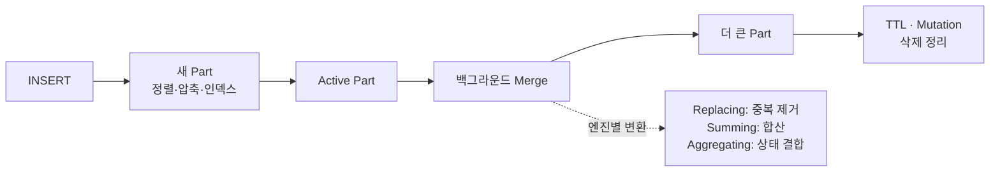
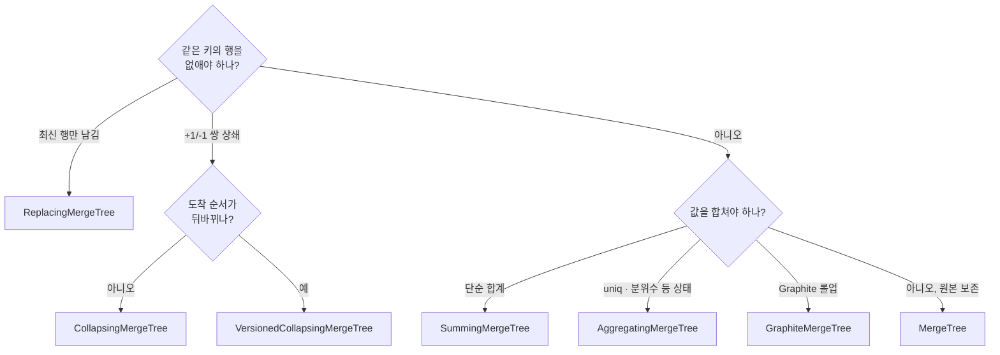
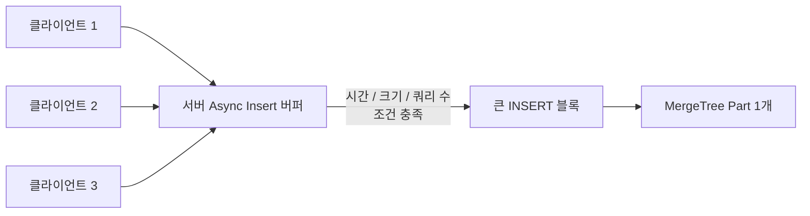
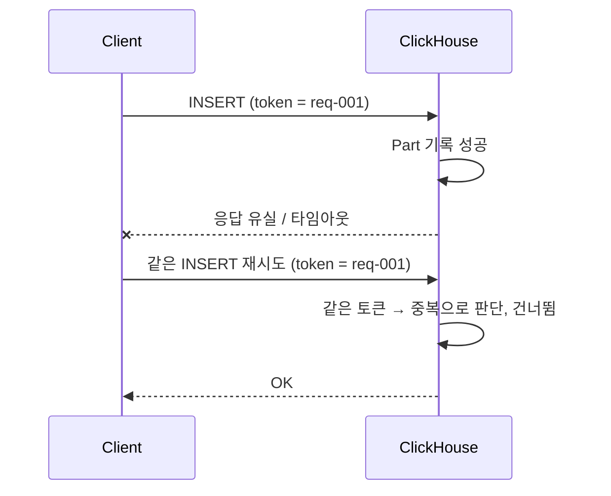
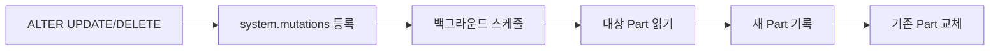
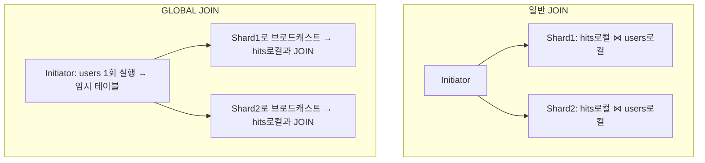

『Learn ClickHouse 마스터클래스』 5장 MergeTree 엔진 패밀리 · 6장 고급 SQL과 DML을 공부하며 정리한 스터디 자료입니다.
교재 내용을 제 말로 다시 풀어 쓰고, **ClickHouse 25.8 Docker 컨테이너에서 직접 돌려 보며** 확인했습니다. 🔬 표시가 붙은 결과는 모두 실측값이고, 교재와 실제 동작이 다른 부분은 정오표로 모았습니다.

**두 장을 관통하는 한 문장**

> MergeTree에서 "데이터가 바뀌는 순간"은 INSERT가 아니라 **Merge**다. 엔진(Replacing·Summing·Aggregating·Collapsing)은 Merge 때 무슨 변환을 할지 정하고, 6장의 INSERT·DML·집계 SQL은 모두 "Part를 몇 개, 어떤 모양으로 만들 것인가"의 문제로 돌아온다.

---

## 5장. MergeTree 엔진 패밀리

### 5.1 MergeTree는 "엔진 이름"이 아니라 "데이터 수명 주기"



- MergeTree 테이블 하나 = **불변 Part 여러 개의 모음**. 쿼리는 여러 Part를 읽어 합치고, 백그라운드는 Part를 계속 만들고 합칩니다.
- 특화 엔진의 차이는 **Merge할 때 같은 정렬 키 행들을 어떻게 바꾸는가**뿐입니다.
- 그래서 엔진 선택 = "저장 형식" 선택이 아니라 **"시간이 지나면 같은 키의 행들이 어떻게 변해야 하는가"** 선택입니다.

---

### 5.2 Part 디렉터리 해부

#### Part 이름 읽기: `202408_1_5_2_3`

| 위치 | 의미 |
| --- | --- |
| `202408` | 파티션 ID (`toYYYYMM(...)` 결과) |
| `1` · `5` | 이 Part가 담은 INSERT 블록 번호의 최소·최대 |
| `2` | Merge 레벨 (합쳐질 때마다 증가) |
| `3` | Mutation 버전 (없으면 생략) |

#### Part 안의 파일 (교재 표 + 25.8 실제 이름)

| 역할 | 교재 표기 | 🔬 25.8 실제 파일 |
| --- | --- | --- |
| 컬럼 데이터 | `컬럼.bin` | `컬럼.bin` (Wide) / `data.bin` (Compact) |
| Mark (Granule → 압축 블록 위치) | `.mrk2` · `.mrk3` | **`.cmrk2`** (Wide) / **`data.cmrk4`** (Compact) — 압축된 Mark |
| 희소 기본키 인덱스 | `primary.idx` | **`primary.cidx`** — 압축된 인덱스 |
| 파티션 프루닝용 min/max | `minmax_*.idx` | `minmax_event_time.idx` |
| 행 수 · 컬럼 목록 · 체크섬 | `count.txt` · `columns.txt` · `checksums.txt` | 동일 + `serialization.json`, `columns_substreams.txt` |

> 💡 25.8은 `compress_marks = 1`, `compress_primary_key = 1`이 기본값이라 파일 이름 앞에 `c`가 붙습니다. 교재 그림의 `.mrk2`, `primary.idx`는 개념도로 보면 됩니다.

#### Compact Part vs Wide Part

| | Compact | Wide |
| --- | --- | --- |
| 파일 구조 | 모든 컬럼을 `data.bin` 하나에 | 컬럼마다 `.bin` + Mark |
| 장점 | 파일 수가 적음 (작은 INSERT에 유리) | 필요한 컬럼만 골라 읽기, 병렬 I/O |
| 기준 | `min_bytes_for_wide_part` 미만 | 그 이상 |

#### 🔬 실측: 작은 INSERT와 큰 INSERT는 다른 형식이 된다

```sql
CREATE TABLE pf (d Date, k UInt64, s String)
ENGINE = MergeTree PARTITION BY toYYYYMM(d) ORDER BY k;
INSERT INTO pf VALUES ('2024-08-01', 1, 'a');                                   -- 1행
INSERT INTO pf SELECT '2024-08-02', number, repeat('x', 100) FROM numbers(200000); -- 20만 행

SELECT name, part_type, rows, formatReadableSize(bytes_on_disk)
FROM system.parts WHERE table = 'pf' AND active;
```

| name | part_type | rows | size |
| --- | --- | --- | --- |
| `202408_1_1_0` | **Compact** | 1 | 416 B |
| `202408_2_2_0` | **Wide** | 200,000 | 863 KiB |

- `min_bytes_for_wide_part` 기본값은 **10,485,760 (10 MiB)** — 교재 수치와 같습니다.
- Compact는 파일 수를 줄여 줄 뿐, **Part 개수가 늘어나는 문제는 그대로**입니다. Part 수는 INSERT 배치 크기와 Merge 속도가 정합니다.

---

### 5.3 MergeTree와 LSM-Tree

| | 전통적 LSM-Tree | ClickHouse MergeTree |
| --- | --- | --- |
| 데이터 단위 | Memtable · SSTable | Part |
| 계층 | Level 0, 1, 2… 명시적 | 레벨 없음. 모든 Part가 병합 후보 |
| 병합 기준 | Level 정책 | Part 크기·개수·디스크 여유·비용 |
| 병합 목적 | 읽기 경로 정리 | 정렬 Part 통합 + **엔진별 변환** |
| 분석 특화 | 구현마다 다름 | 컬럼 저장 · 희소 인덱스 · 벡터화와 결합 |

- 공통점: 제자리 수정 대신 **새 단위로 순차 기록 → 백그라운드 병합**. 그래서 둘 다 **쓰기 증폭**이 생깁니다.
- 정확한 표현: "MergeTree = LSM의 '새로 쓰고 나중에 합치는' 원리를 **컬럼 분석 저장**에 결합한 엔진". 같은 것이라고 하면 틀립니다.

---

### 5.4 엔진 선택 결정 트리



| 엔진 | Merge 때 하는 일 | 대표 용도 |
| --- | --- | --- |
| MergeTree | 정렬 병합만 | 원시 로그 · 시계열 |
| ReplacingMergeTree(ver, is_deleted) | 같은 키 중 최신 버전만 남김 | CDC 최신 상태 |
| SummingMergeTree | 숫자 컬럼 합산 | 노출·클릭·비용 롤업 |
| AggregatingMergeTree | `AggregateFunction` 상태 결합 | MV 기반 집계 큐브 |
| CollapsingMergeTree(Sign) | +1 / -1 쌍 상쇄 | 상태·취소 이벤트 |
| VersionedCollapsingMergeTree(Sign, Ver) | 같은 버전끼리 +1/-1 상쇄 | 순서가 뒤섞이는 이벤트 |
| GraphiteMergeTree | Graphite 규칙으로 다운샘플 | Graphite 메트릭 전용 |

> 선택 기준은 "편해서"가 아니라 **Merge 결과가 데이터의 의미를 지키는가**입니다.

---

### 5.5 ~ 5.6 ReplacingMergeTree와 FINAL

- 같은 정렬 키의 행을 **Merge할 때** 정리합니다. INSERT 순간에 막지 않습니다 → **UNIQUE 제약이 아님**.
- `ver`를 주면 큰 버전이 이기고, `is_deleted = 1`인 최신 행은 "삭제됨"을 뜻하는 톰스톤입니다.
- `FINAL` = 쿼리 시점에 대체 규칙을 적용해서 읽기. 정확하지만 읽기·메모리 비용이 듭니다.

#### 🔬 실측: 중복은 언제 사라지나? 톰스톤은 언제 지워지나?

```sql
CREATE TABLE r (id UInt64, ver UInt64, del UInt8, name String)
ENGINE = ReplacingMergeTree(ver, del) ORDER BY id;
INSERT INTO r VALUES (1, 1, 0, 'v1');
INSERT INTO r VALUES (1, 2, 0, 'v2');
INSERT INTO r VALUES (2, 1, 0, 'x');
INSERT INTO r VALUES (2, 2, 1, 'x-deleted');   -- id=2 삭제 톰스톤

SELECT count() FROM r;          -- 4   ← 아직 아무것도 정리 안 됨
SELECT * FROM r FINAL;          -- (1, 2, 0, 'v2')  ← id=2는 숨겨짐
OPTIMIZE TABLE r FINAL;
SELECT * FROM r;                -- (1, 2, 0, 'v2'), (2, 2, 1, 'x-deleted')  ← 톰스톤은 남아 있음!
```

| 시점 | 결과 |
| --- | --- |
| INSERT 직후, FINAL 없이 | 4행 그대로 (중복·톰스톤 모두 보임) |
| `FINAL` 조회 | 최신 행만, **톰스톤 행은 결과에서 제외** |
| `OPTIMIZE FINAL` 후 일반 조회 | 중복은 정리됐지만 **톰스톤 행은 물리적으로 남아 있음** |

> ⚠️ 교재는 "is_deleted 행이 Merge 시점에 제거될 수 있다"고 쓰지만, 25.8 기본값에서 **일반 Merge는 톰스톤을 지우지 않습니다.** 지우려면 `allow_experimental_replacing_merge_with_cleanup = 1`(기본 0) 설정 후 `OPTIMIZE ... FINAL CLEANUP`이 필요합니다. 그래서 톰스톤을 쓰는 테이블은 **항상 FINAL(또는 `WHERE del = 0`)로 읽어야** 합니다.

#### FINAL 관련 설정 (25.8 기본값)

| 설정 | 기본값 | 의미 |
| --- | --- | --- |
| `max_final_threads` | `auto(코어 수)` | FINAL도 병렬로 처리 |
| `do_not_merge_across_partitions_select_final` | 0 | 1이면 파티션끼리는 합치지 않음 → 같은 키가 여러 파티션에 있으면 **중복이 남을 수 있음** |

---

### 5.7 ~ 5.8 SummingMergeTree vs AggregatingMergeTree

| 요구사항 | Summing | Aggregating |
| --- | --- | --- |
| 노출 · 클릭 · 매출 합계 | ✅ | ✅ (`SimpleAggregateFunction(sum, …)`) |
| 평균 | 합계·건수를 따로 저장해야 | ✅ `avgState` |
| 고유 사용자 수 | ❌ (더하면 중복 집계) | ✅ `uniqState` |
| 분위수 | ❌ | ✅ `quantilesState` |

#### 🔬 실측: SummingMergeTree의 문자열 컬럼은 어떻게 되나?

```sql
CREATE TABLE sm (k UInt64, c UInt64, label String) ENGINE = SummingMergeTree ORDER BY k;
INSERT INTO sm VALUES (1, 10, 'first');
INSERT INTO sm VALUES (1, 5, 'second');
OPTIMIZE TABLE sm FINAL;
SELECT * FROM sm;   -- (1, 15, 'first')
```

- 숫자는 15로 합쳐졌고, 문자열은 **둘 중 하나('first')만 남고 'second'는 사라졌습니다.** 비숫자 컬럼을 믿어야 하는 테이블에 Summing을 쓰면 안 되는 이유입니다.

#### -State 저장 → -Merge 조회


#### 🔬 실측: 교재 조회 예제의 문법

```sql
-- 교재: quantilesMerge(quantiles)(quantiles)
SELECT quantilesMerge(q)(q) FROM ag;
-- ❌ Code: 36. Parameter for function 'quantilesMerge' expected to have constant value

SELECT quantilesMerge(0.5, 0.95)(q) FROM ag;
-- ✅ [49.5, 94.05]
```

> 파라미터 자리에는 **컬럼이 아니라 상수(분위 값)** 를 다시 써야 합니다. 저장할 때 `quantilesState(0.5, 0.95)`로 만들었으면 조회도 `quantilesMerge(0.5, 0.95)`.

---

### 5.9 ~ 5.11 Collapsing 계열과 Graphite

| 상황 | CollapsingMergeTree | VersionedCollapsingMergeTree |
| --- | --- | --- |
| 이벤트 순서가 안정적 | 사용 가능 | 사용 가능 |
| 취소(-1)가 상태(+1)보다 먼저 도착 | **상쇄 실패 위험** | 같은 `(키, Version)`끼리 매칭 |
| Kafka · 비동기 큐 | 순서 보장 필요 | Version·Sign 생성 규칙이 파이프라인 전체에서 일관돼야 |

- Versioned도 만능은 아닙니다. 같은 이벤트가 **두 번** 들어오거나 버전 규칙이 깨지면 결과가 틀어집니다.
- GraphiteMergeTree는 Graphite 보존 규칙을 쓰는 환경 전용입니다. 일반 로그 테이블의 선택지가 아닙니다.

---

### 5.12 ReplacingMergeTree 운영 원칙

| 목표 | 설계 |
| --- | --- |
| 원본 변경 이벤트 보존 | 기본 MergeTree (원본 로그) |
| 최신 상태 읽기 모델 | ReplacingMergeTree |
| 쿼리 시점 중복 제거 | `FINAL` 또는 `argMax` 패턴 |
| 실시간 강한 유일성 | **ReplacingMergeTree만으로는 불가능** |

---

### 5.13 Mutation vs Lightweight DELETE (vs Lightweight UPDATE)

| | Mutation `ALTER TABLE … UPDATE/DELETE` | Lightweight DELETE `DELETE FROM` | 🆕 Lightweight UPDATE `UPDATE … SET` |
| --- | --- | --- | --- |
| 초기 동작 | 대상 Part를 새로 씀 | `_row_exists` 마스크 기록 | 바뀐 값만 담은 **patch part** 생성 |
| 쓰기 I/O | 큼 | 작음 | 작음 |
| SELECT 비용 | 완료 후 일반 경로 | 마스크 평가 | patch 적용 |
| 물리 반영 | 새 Part 교체 | 이후 Merge | 이후 Merge |
| 25.8 기본 동작 | 비동기 (`mutations_sync = 0`) | **동기** (`lightweight_deletes_sync = 2`) | 테이블에 `_block_number` 컬럼 필요 |

#### 🔬 실측 1: Mutation은 "전체 컬럼"을 다시 쓰나?

교재는 "전체 컬럼 파일을 다시 쓸 수 있다"고 표현합니다. 25.8에서 확인해 보면 **바뀐 컬럼만** 새로 씁니다.

```sql
CREATE TABLE mu (k UInt64, a String, b String) ENGINE = MergeTree ORDER BY k
SETTINGS min_bytes_for_wide_part = 0;
INSERT INTO mu SELECT number, toString(number), toString(number) FROM numbers(1000);
ALTER TABLE mu UPDATE a = 'x' WHERE k = 1 SETTINGS mutations_sync = 1;
-- 새 Part all_1_1_0_2 의 파일 하드링크 수 (stat -c %h)
```

| 파일 | 하드링크 수 | 의미 |
| --- | --- | --- |
| `a.bin` | **1** | 새로 씀 (UPDATE 대상) |
| `b.bin` | **2** | 옛 Part와 공유 (안 씀) |
| `k.bin` | **2** | 옛 Part와 공유 (안 씀) |

> 그래도 **Part 단위** 작업이라는 점은 같습니다. 1행을 고쳐도 그 Part의 `a` 컬럼 전체를 다시 씁니다.

#### 🔬 실측 2: Lightweight DELETE의 정체

```sql
DELETE FROM ld WHERE k < 3;
SELECT command FROM system.mutations WHERE table = 'ld';
-- (UPDATE _row_exists = 0 WHERE k < 3)     ← 내부적으로는 "마스크 컬럼을 쓰는 Mutation"
SELECT name FROM system.parts WHERE table = 'ld' AND active;
-- all_1_1_0_2                               ← Part 이름에 Mutation 버전이 붙음
```

#### 🔬 실측 3: 25.8의 Lightweight UPDATE (교재 범위 밖)

```sql
UPDATE lu SET v = 'new' WHERE k = 1;
-- ❌ Lightweight updates are supported only for tables with materialized _block_number column

CREATE TABLE lu2 (k UInt64, v String) ENGINE = MergeTree ORDER BY k
SETTINGS enable_block_number_column = 1, enable_block_offset_column = 1;
INSERT INTO lu2 SELECT number, 'old' FROM numbers(5);
UPDATE lu2 SET v = 'new' WHERE k = 1;      -- ✅
SELECT name, rows FROM system.parts WHERE table = 'lu2' AND active;
-- all_1_1_0                          5
-- patch-…-all_3_3_0_2                1   ← 바뀐 1행만 담은 patch part
```

> ⚠️ Lightweight DELETE가 "즉시 디스크에서 사라짐"은 아닙니다. 개인정보 파기처럼 **물리 삭제**가 필요하면 Merge 완료(또는 Mutation 완료)까지 추적해야 합니다.

---

### 5.14 TTL: 데이터 수명 주기를 DDL로

| TTL 종류 | 하는 일 | 주의 |
| --- | --- | --- |
| 행 삭제 `… DELETE` | 만료 행 제거 | Part 전체가 만료여야 Part째 삭제 (`ttl_only_drop_parts = 0`이 기본이라 보통은 행 단위 재작성) |
| 컬럼 TTL | 컬럼 값만 기본값으로 초기화 | 빈 문자열/0이 "원래 값"과 헷갈리지 않게 |
| `RECOMPRESS CODEC(…)` | 오래된 데이터를 강한 코덱으로 | 재압축 CPU · Merge 비용 |
| `GROUP BY … SET …` 롤업 | 오래된 원본을 집계로 축소 | 롤업 후 원본 행 질의 불가 |
| `TO VOLUME / TO DISK` | Hot → Cold 이동 | Cold 조회 지연, S3 장애가 쿼리에 영향 |

#### 🔬 실측: TTL GROUP BY 키 제약

```sql
CREATE TABLE tg (d DateTime, cc String, views UInt64) ENGINE = MergeTree
ORDER BY (cc, d)
TTL d + INTERVAL 90 DAY GROUP BY toStartOfDay(d), cc SET views = sum(views);
-- ❌ Code: 450. TTL Expression GROUP BY key should be a prefix of primary key

-- ✅ GROUP BY 키를 ORDER BY 앞부분과 똑같이 맞추면 생성됨
ORDER BY (toStartOfDay(d), cc, d)
```

> 교재 예시는 TTL 절만 보여 주고 이 제약을 말하지 않습니다. **롤업 TTL은 정렬 키 설계부터 맞춰야** 합니다.

#### TTL은 언제 실행되나?

- 만료 시각에 즉시 도는 별도 프로세스가 아니라 **Merge에 붙어서** 실행됩니다.
- `merge_with_ttl_timeout` 기본값 **14,400초(4시간)** — TTL Merge 사이의 최소 간격입니다. 만료 후 바로 사라지지 않는 이유입니다.

#### 계층형 스토리지 (Hot · Warm · Cold)

| 계층 | 저장소 | 데이터 |
| --- | --- | --- |
| Hot | 로컬 NVMe | 최근 · 자주 조회 |
| Warm | 저비용 블록 스토리지 | 중간 |
| Cold | S3 · GCS | 장기 보존 · 가끔 조회 |

> ⚠️ 교재 예시의 storage policy XML은 볼륨 이름이 `hot`/`cold`인데, DDL은 `TO VOLUME 's3_cold'`를 씁니다. **볼륨 이름이 서로 맞아야** 동작합니다.

---

### 5.16 엔진 선택 시나리오 요약

| 시나리오 | 선택 | 한 줄 이유 |
| --- | --- | --- |
| 원본 웹 로그 보존 | MergeTree | 의미 보존. 집계는 MV로 분리 |
| PostgreSQL CDC 최신 상태 | ReplacingMergeTree(version, is_deleted) | FINAL 또는 최신 상태 뷰 결정 필요 |
| 광고 노출·클릭 롤업 | SummingMergeTree | uniq·분위수가 필요해지면 Aggregating으로 |
| Kafka 순서 역전 이벤트 | VersionedCollapsingMergeTree | Version·Sign 규칙 일관성 |
| 개인정보 삭제 | Lightweight DELETE → 필요 시 Mutation 완료 추적 | 논리 삭제와 물리 삭제 구분 |

---

## 6장. 고급 SQL과 DML

### 6.1 이 장을 보는 관점


각 기능이 **어떤 비용을 만들고 무엇을 해결하는지**가 핵심입니다. async_insert는 Part 개수를, JOIN 알고리즘은 메모리·디스크·네트워크 비용을, `-State/-Merge`는 다음 장의 MV를, Mutation은 Part 재작성 비용을 다룹니다.

---

### 6.2 단건 INSERT → Part 폭증

- MergeTree는 **INSERT 블록 1개 = Part 1개**. 1~10행짜리 INSERT를 계속 보내면 작은 Part가 Merge 속도보다 빨리 쌓입니다.
- 결과: Merge 스레드·디스크 I/O 고갈 → SELECT가 읽을 Part 증가 → INSERT 지연 → 결국 INSERT 거부.

| 입력 방식 | 장점 | 위험 |
| --- | --- | --- |
| 단건 INSERT | 구현 단순 · 지연 낮음 | Part 폭증 |
| 클라이언트 배치 (수만~십만 행) | Part 수 감소 | 클라이언트 버퍼 · 배치 대기 |
| 서버 `async_insert` | 클라이언트 수정 없이 서버가 모음 | 서버 버퍼 · flush 정책 |

#### 🔬 실측: 실제 에러 메시지와 임계값

```sql
CREATE TABLE tp (k UInt64) ENGINE = MergeTree ORDER BY k
SETTINGS parts_to_throw_insert = 3, parts_to_delay_insert = 2;
SYSTEM STOP MERGES tp;
INSERT INTO tp VALUES (1); INSERT INTO tp VALUES (2); INSERT INTO tp VALUES (3); INSERT INTO tp VALUES (4);
-- ❌ Code: 252. Too many parts (3 with average size of 218.00 B) in table 's6.tp'.
--    Merges are processing significantly slower than inserts. (TOO_MANY_PARTS)
```

| 설정 (25.8 기본값) | 값 | 범위 |
| --- | --- | --- |
| `parts_to_delay_insert` | **1000** | 파티션 하나의 Active Part 수 → INSERT를 일부러 늦춤 |
| `parts_to_throw_insert` | **3000** | 파티션 하나 → INSERT 거부 (`TOO_MANY_PARTS`) |
| `max_parts_in_total` | 100000 | 테이블 전체 |

> 교재의 `Too many parts in all data parts in table`은 테이블 전체 한도(`max_parts_in_total`) 쪽 메시지입니다. 작은 INSERT를 반복해서 실제로 먼저 만나는 건 위의 **파티션 단위** 메시지입니다.

---

### 6.3 async_insert 내부 동작



#### 🔬 실측: 25.8 기본값 (교재와 다른 부분 ⚠️)

| 설정 | 교재 | 25.8 실제 |
| --- | --- | --- |
| `async_insert` | — | 0 (꺼짐) |
| `async_insert_busy_timeout_ms` | 200ms | ⚠️ `async_insert_busy_timeout_max_ms` = 200, 그러나 **적응형**: `async_insert_use_adaptive_busy_timeout = 1`, 최소 `…_min_ms` = 50 |
| `async_insert_max_data_size` | 약 100KB ~ 1MB | ⚠️ **10,485,760 (10 MiB)** |
| `async_insert_max_query_number` | (언급 없음) | 450 — 쿼리 개수로도 flush |
| `wait_for_async_insert` | — | **1** (기본이 "flush까지 기다림") |
| `wait_for_async_insert_timeout` | — | 120초 |

#### wait_for_async_insert

| 값 | 응답 시점 | 의미 |
| --- | --- | --- |
| 1 (기본) | flush되어 Part 기록 경로를 지난 뒤 | 신뢰성 우선 |
| 0 | 서버 버퍼에 들어간 직후 | Fire-and-forget. 서버 재시작 시 버퍼 내용 **유실 가능**, flush 실패를 클라이언트가 모름 |

> async_insert는 **입력량이 Merge·디스크 처리량을 넘는 문제를 숨길 뿐** 해결하지 않습니다. 버퍼 증가, Merge backlog, Part 수를 같이 봐야 합니다.

---

### 6.4 INSERT 멱등성: 재시도하면 두 번 들어가나?



- 재시도할 때 **토큰을 새로 만들면 안 됩니다.** 같은 논리 요청이면 같은 토큰.

#### 🔬 실측: 일반 MergeTree에서 토큰만 주면 중복이 막힐까?

```sql
CREATE TABLE d0 (k UInt64) ENGINE = MergeTree ORDER BY k;          -- 기본 설정
INSERT INTO d0 SETTINGS insert_deduplication_token = 't1' VALUES (1);
INSERT INTO d0 SETTINGS insert_deduplication_token = 't1' VALUES (1);
SELECT count() FROM d0;   -- 2   ❌ 중복 그대로 들어감

CREATE TABLE d1 (k UInt64) ENGINE = MergeTree ORDER BY k
SETTINGS non_replicated_deduplication_window = 100;
-- 같은 INSERT 두 번
SELECT count() FROM d1;   -- 1   ✅ 중복 차단
```

| 설정 (25.8 기본값) | 값 | 의미 |
| --- | --- | --- |
| `non_replicated_deduplication_window` | **0** | 일반 MergeTree는 **기본적으로 중복 제거 꺼짐** |
| `replicated_deduplication_window` | **1000** | Replicated는 최근 1000개 블록 해시 기억 (교재 "기본 100개"는 예전 값) |
| `replicated_deduplication_window_seconds` | 604800 (7일) | 시간 기준 창 |
| `replicated_deduplication_window_for_async_inserts` | 10000 | async insert용 창 |

> ⚠️ 교재는 이 차이를 말하지 않습니다. **ReplicatedMergeTree가 아니면 window를 직접 켜야** 토큰이 의미가 있습니다.

토큰이 **보장하지 않는 것**: 서로 다른 토큰의 같은 이벤트(의미적 중복), 창 밖의 오래된 재시도, 잘못된 토큰 생성 정책, 분산 경로 전체의 전역 유일성.

---

### 6.5 Mutation DML과 mutations_sync



| `mutations_sync` | 반환 시점 |
| --- | --- |
| 0 (25.8 기본) | 등록만 하고 즉시 반환 |
| 1 | 현재 노드에서 완료될 때까지 대기 |
| 2 | 모든 레플리카에서 완료될 때까지 대기 |

> "SQL이 OK를 돌려줬다" ≠ "데이터 재작성이 끝났다". 운영에서는 `system.mutations WHERE is_done = 0`과 `latest_fail_reason`을 봐야 합니다.

---

### 6.6 JOIN 실행 원리

- Hash Join: **오른쪽 = Build**(해시 테이블), **왼쪽 = Probe**(스트리밍). 그래서 오른쪽 크기가 메모리를 결정하고, 전통적 규칙은 "작은 테이블을 오른쪽에".

| `join_algorithm` | 동작 | 적합한 상황 |
| --- | --- | --- |
| `hash` | 오른쪽 전체를 메모리 해시 테이블로 | 오른쪽이 메모리에 들어감 |
| `parallel_hash` | 해시 테이블을 여러 파티션으로 나눠 병렬 Build/Probe | 멀티코어 · 메모리 여유 (메모리 더 씀) |
| `grace_hash` | 버킷으로 나눠 디스크 스필 | 오른쪽이 메모리 초과 |
| `full_sorting_merge` | 양쪽 정렬 후 병합 | 아주 큰 데이터 · 이미 정렬됨 |
| `direct` | Dictionary / KV 저장소 직접 조회 | 코드 · 마스터 데이터 |

#### 🔬 실측: 25.8 기본값은 교재 뉘앙스와 다르다

| 설정 | 25.8 기본값 | 의미 |
| --- | --- | --- |
| `join_algorithm` | **`direct,parallel_hash,hash`** | 가능하면 direct → 아니면 **parallel_hash가 이미 기본** |
| `query_plan_join_swap_table` | **`auto`** | 옵티마이저가 작은 쪽을 Build로 **자동 교환** 가능 |
| `max_bytes_in_join` | 0 (무제한) | 걸리면 `join_overflow_mode`에 따라 동작 |

> "작은 테이블을 오른쪽에"는 여전히 안전한 습관이지만, 25.8에서는 옵티마이저가 바꿔 주기도 합니다. `EXPLAIN`으로 실제 Build 쪽을 확인하세요.

---

### 6.7 분산 JOIN vs GLOBAL JOIN



#### 🔬 실측: 샤딩 키가 다르면 정말 결과가 빠지나? (2샤드 클러스터)

같은 서버에 샤드 2개짜리 테스트 클러스터를 만들고, `hits`와 `users`를 **서로 다른 규칙으로** 나눠 넣었습니다.

| | shard 1 | shard 2 |
| --- | --- | --- |
| hits.user_id | 2, 4 | 1, 3 |
| users (user_id, country) | (1, KR), (2, US) | (3, JP), (4, DE) |

```sql
-- 1) 교재처럼 Distributed끼리 일반 JOIN
SELECT h.user_id, u.country FROM dh AS h JOIN du AS u ON h.user_id = u.user_id;
-- ❌ Code: 288. Double-distributed IN/JOIN subqueries is denied (distributed_product_mode = 'deny')

-- 2) 교재가 설명하는 "샤드별 로컬 JOIN"을 강제
... SETTINGS distributed_product_mode = 'local';
-- (2, US), (3, JP)                     ← 4건 중 2건만! 1·4번 사용자 누락

-- 3) GLOBAL JOIN
SELECT h.user_id, u.country FROM dh AS h GLOBAL JOIN du AS u ON h.user_id = u.user_id;
-- (1, KR), (2, US), (3, JP), (4, DE)   ← 4건 모두
```

| 방식 | 25.8 결과 | 비용 |
| --- | --- | --- |
| 일반 JOIN (기본 `deny`) | **에러** — 교재 설명과 달리 실행 자체가 막힘 | — |
| `distributed_product_mode = 'local'` | **2/4건** (샤딩 불일치로 누락) | 네트워크 적음 |
| `GLOBAL JOIN` | **4/4건** | 오른쪽 결과 × 샤드 수만큼 전송 · 각 샤드 메모리 |

> ⚠️ 교재 6.7.1은 "각 샤드에서 로컬끼리 JOIN된다"고 설명하지만, 25.8 기본값(`distributed_product_mode = 'deny'`)에서는 **에러가 납니다.** 교재가 말하는 동작은 `'local'` 모드이고, 그 경우 실제로 데이터가 빠지는 것까지 확인했습니다.

GLOBAL JOIN을 피할 때: 오른쪽 결과가 큼, 샤드 수가 많음, 네트워크 제한, **Dictionary(direct JOIN)로 대체 가능**, 같은 샤딩 키로 재배치 가능.

---

### 6.8 집계 함수 콤비네이터

| 접미사 | 하는 일 | 예 |
| --- | --- | --- |
| `-If` | 조건이 참인 행만 집계 | `countIf(status = 200)`, `avgIf(latency, country = 'KR')` |
| `-Array` | 배열 원소를 펼치지 않고 집계 | `sumArray(item_prices)` |
| `-State` | 최종 값 대신 **중간 상태** 반환 | `uniqState(user_id)` |
| `-Merge` | 상태들을 합쳐 최종 값 | `uniqMerge(state_col)` |
| `-ForEach` | **여러 행의 배열**을 같은 위치끼리 집계 | `sumForEach(arr)` |
| `-Resample` | 키 범위를 고정 구간으로 나눠 집계 | `avgResample(start, end, step)(v, key)` |

- `-If`의 진짜 가치: CASE WHEN이나 서브쿼리 없이 **여러 조건부 집계를 한 번의 스캔**에.

#### 🔬 실측: 교재 예제 두 개는 그대로 쓰면 틀린다

```sql
-- 교재 6.8.5
SELECT sumForEach([1, 2, 3], [10, 20, 30]);
-- ❌ Code: 42. Aggregate function sum requires single argument

-- -ForEach는 "행 사이" 집계. 배열 두 개를 두 행으로 넣어야 함
SELECT sumForEach(arr) FROM (SELECT [1, 2, 3] AS arr UNION ALL SELECT [10, 20, 30]);
-- ✅ [11, 22, 33]
```

```sql
-- 교재 6.8.6: event_time(DateTime)을 그대로 키로 사용
SELECT avgResample(0, 86400, 3600)(latency, event_time) FROM logs;
-- [nan, nan, … nan]  (24칸 전부 비어 있음)
-- DateTime 값은 유닉스 초(약 17억)라서 0~86400 구간에 하나도 안 들어감

-- 하루 시작 기준 상대 초로 바꾸면 동작
SELECT avgResample(0, 86400, 3600)(latency,
       toUInt32(event_time) - toUInt32(toDateTime('2026-08-26 00:00:00'))) FROM logs;
-- ✅ 24칸, 첫 칸 = 29.5
```

```sql
-- 콤비네이터 체이닝: 순서에 따라 인자 모양이 다름
SELECT finalizeAggregation(sumIfArrayState([1, 2, 3], [1, 0, 1]));  -- 4 (배열 두 개: 값, 조건)
SELECT sumArrayIf([1, 2, 3], 1);                                     -- 6 (배열 + 스칼라 조건)
```

---

### 6.9 windowFunnel: 전환 퍼널

- `windowFunnel(window)(timestamp, cond1, cond2, …)` → 사용자가 **몇 단계까지** 순서대로 도달했는지(0 ~ N) 반환.
- 자기 조인이나 단계별 중간 테이블 없이 **한 번의 스캔**으로 계산.

#### 🔬 실측: 창(window)은 어디서부터 재나?

교재는 "**직전 단계 이후** window 안에 다음 단계가 오는지"라고 설명합니다. 직접 확인해 봤습니다.

```sql
-- A(10:00) → B(10:20) → C(10:40). 단계 간격은 20분씩, 전체는 40분. 창 = 30분.
INSERT INTO ev VALUES (1, '2026-08-26 10:00:00', 'A'),
                      (1, '2026-08-26 10:20:00', 'B'),
                      (1, '2026-08-26 10:40:00', 'C');
SELECT windowFunnel(1800)(t, e = 'A', e = 'B', e = 'C') FROM ev GROUP BY uid;
-- 2
```

| 해석 | 예상 결과 |
| --- | --- |
| 교재: 직전 단계 기준 (20분 < 30분 둘 다 통과) | 3 |
| 공식 문서: **첫 단계 기준** (C는 첫 이벤트로부터 40분 > 30분) | **2** ← 실제 |

> ⚠️ 창은 **첫 번째 조건을 만족한 시점부터** 잽니다. "30분 안에 결제까지"는 "장바구니 후 30분"이 아니라 "첫 조회 후 30분"입니다. 같은 timestamp 처리, 중복 이벤트 처리를 위한 모드(`'strict_order'`, `'strict_deduplication'`, `'strict_increase'`)도 교재에는 빠져 있습니다.

---

### 6.10 retention: 코호트 리텐션

- `retention(cond1, cond2, …)` → `UInt8` 배열. **cond1(기준)** 을 만족한 사용자가 이후 조건도 만족했는지.

#### 🔬 실측: 첫 조건이 거짓이면?

```sql
SELECT retention(0, 1, 1), retention(1, 0, 1);
-- [0, 0, 0]   [1, 0, 1]
```

- r[i] (i ≥ 2) = **"첫 조건 AND i번째 조건"**. 기준일에 오지 않은 사용자는 이후에 와도 전부 0입니다. 배열 인덱스는 1부터.

### 6.11 sequenceMatch · sequenceCount

| 함수 | 용도 |
| --- | --- |
| `windowFunnel` | 정해진 단계의 **최대 도달 수준** |
| `sequenceMatch` | 패턴(예: `'(?1)(?t<=3600)(?2)'`)을 만족하는가 |
| `sequenceCount` | 그 패턴이 몇 번 나왔는가 |

### 6.12 arrayJoin과 배열 평탄화 비용

- 배열 원소 N개 → **N행으로 확장**. "공짜 평탄화"가 아닙니다. 이후 필터·집계·정렬 비용이 N배.

| 요구사항 | 우선 검토 |
| --- | --- |
| 배열 전체 합계 | `sumArray` (펼치지 않음) |
| 인덱스별 집계 | `sumForEach` |
| 원소별 필터 · JOIN | `ARRAY JOIN` / `arrayJoin` |
| 아주 긴 배열 | 중간 행 폭증과 메모리 측정 먼저 |

#### 🔬 실측: 빈 배열 행은 사라진다 (교재에 없는 함정)

```sql
SELECT id, x FROM (SELECT 1 id, [10, 20] a UNION ALL SELECT 2, []::Array(UInt8))
ARRAY JOIN a AS x;
-- (1, 10), (1, 20)            ← id = 2 행이 사라짐!

... LEFT ARRAY JOIN a AS x;
-- (1, 10), (1, 20), (2, 0)    ← 보존하려면 LEFT ARRAY JOIN
```

---

## 📌 교재 vs 실제 (25.8) 정오표

| 교재 내용 | 실제 확인 결과 |
| --- | --- |
| Part 파일 `primary.idx`, `.mrk2` | `primary.cidx`, `.cmrk2` (압축 Mark/인덱스가 기본) |
| `is_deleted` 행이 Merge 때 제거될 수 있음 | 일반 `OPTIMIZE FINAL`로는 **안 지워짐**. `FINAL CLEANUP` + 실험 설정 필요 |
| `quantilesMerge(quantiles)(quantiles)` | **에러**. 파라미터는 상수: `quantilesMerge(0.5, 0.95)(col)` |
| Mutation이 전체 컬럼 파일을 다시 씀 | **바뀐 컬럼만** 새로 씀 (나머지는 하드링크) |
| UPDATE는 Mutation뿐 | 25.8에 Lightweight UPDATE(patch part) 있음. `_block_number` 컬럼 필요 |
| TTL GROUP BY 예시 | GROUP BY 키가 **정렬 키의 접두사**여야 함 (아니면 `BAD_TTL_EXPRESSION`) |
| `TO VOLUME 's3_cold'` | 예시 XML의 볼륨 이름(`hot`/`cold`)과 불일치 |
| `Too many parts in all data parts` | 실제로 먼저 만나는 건 파티션 단위 `TOO_MANY_PARTS` (기본 3000) |
| `async_insert_max_data_size` ≈ 100KB~1MB | **10 MiB**. busy timeout도 50~200ms **적응형** |
| 중복 제거 "최근 100개 Part" | Replicated **1000개**. 일반 MergeTree는 기본 **0 (꺼짐)** |
| `join_algorithm` 선택 | 기본값 `direct,parallel_hash,hash` + 좌우 자동 교환(`auto`) |
| Distributed끼리 일반 JOIN = 샤드별 로컬 JOIN | 기본 `deny` → **에러**. `local`로 바꾸면 샤딩 불일치 시 실제로 누락 |
| `sumForEach([1,2,3], [10,20,30])` → [11,22,33] | **에러**. 두 배열을 두 행으로 넣어야 함 |
| `avgResample(0, 86400, 3600)(latency, event_time)` | DateTime이면 **모든 구간이 nan**. 상대 초로 변환 필요 |
| windowFunnel: 직전 단계 기준 창 | **첫 단계 기준** 창 (실측 결과 2단계) |
| `ARRAY JOIN` 예시 | 빈 배열 행은 결과에서 빠짐 → `LEFT ARRAY JOIN` |

---

## 🧩 퀴즈

**Q1.** ReplacingMergeTree에 같은 `id`로 버전 1, 2를 각각 INSERT한 직후 `SELECT count() FROM t`는? 왜?

**Q2.** `ReplacingMergeTree(ver, is_deleted)`에서 `OPTIMIZE TABLE t FINAL`을 실행하면 `is_deleted = 1`인 최신 행은 디스크에서 사라질까?

**Q3.** SummingMergeTree에 `(k=1, c=10, label='first')`, `(k=1, c=5, label='second')`를 따로 넣고 병합하면 `label`은?

**Q4.** 컬럼 `a`, `b`, `k`가 있는 Wide Part에서 `ALTER TABLE … UPDATE a = 'x' WHERE k = 1`을 실행하면 새로 쓰이는 `.bin` 파일은?

**Q5.** `DELETE FROM t WHERE …`(Lightweight DELETE)는 `system.mutations`에 남을까? 남는다면 어떤 명령으로?

**Q6.** 일반(비복제) MergeTree에 같은 `insert_deduplication_token`으로 INSERT를 두 번 하면 몇 행이 될까? (25.8 기본 설정)

**Q7.** 25.8 기본 설정에서 Distributed 테이블끼리 `JOIN`(GLOBAL 없이)을 하면 어떻게 될까?

**Q8.** A(10:00) → B(10:20) → C(10:40) 순서의 이벤트에 `windowFunnel(1800)(t, A, B, C)`의 결과는?

**Q9.** `retention(0, 1, 1)`의 결과는?

**Q10.** `ARRAY JOIN`을 했더니 행 수가 원본보다 **줄었다**. 무엇 때문일까?

**Q11.** async_insert를 켰는데도 Part 수가 줄지 않고 Merge backlog가 계속 늘어난다. async_insert의 한계는 무엇일까?

---

<details markdown="1">
<summary><b>정답 보기</b></summary>


1. **2.** 중복 정리는 INSERT가 아니라 Merge 또는 FINAL 시점에 일어납니다. UNIQUE 제약이 아닙니다.
2. **아니다.** 중복은 정리되지만 톰스톤 행은 남습니다. 지우려면 `allow_experimental_replacing_merge_with_cleanup = 1` + `OPTIMIZE … FINAL CLEANUP`.
3. **`'first'` 하나만 남습니다.** 숫자만 합산(15)되고 비숫자 컬럼은 둘 중 하나만 남습니다.
4. **`a.bin`만.** `b.bin`, `k.bin`은 옛 Part와 하드링크로 공유합니다(링크 수 2). 그래도 Part 하나의 `a` 컬럼 전체를 다시 씁니다.
5. **남는다.** `UPDATE _row_exists = 0 WHERE …` 형태의 Mutation으로 기록되고, Part 이름에 Mutation 버전이 붙습니다. 25.8은 `lightweight_deletes_sync = 2`라 동기로 끝납니다.
6. **2행.** `non_replicated_deduplication_window` 기본값이 0이라 중복 제거가 꺼져 있습니다. 100 등으로 켜면 1행.
7. **에러 (`DISTRIBUTED_IN_JOIN_SUBQUERY_DENIED`).** 기본 `distributed_product_mode = 'deny'`. `'local'`이면 샤딩 키가 다를 때 결과가 빠지고, GLOBAL JOIN이면 모두 나옵니다.
8. **2.** 창은 첫 단계(A) 기준입니다. C는 A로부터 40분이라 30분 창 밖입니다.
9. **`[0, 0, 0]`.** 첫(기준) 조건이 거짓이면 이후 플래그도 모두 0입니다.
10. **빈 배열을 가진 행이 사라졌기 때문.** 보존하려면 `LEFT ARRAY JOIN`.
11. 서버 버퍼에서 모아 Part 생성 **빈도**만 줄입니다. 입력량 자체가 Merge·디스크 처리량을 넘으면 문제를 숨길 뿐이고, 배치 크기·파티션 설계·하드웨어를 같이 봐야 합니다.

</details>

---

## 🔑 키워드 심화: ReplacingMergeTree와 FINAL

**왜 필요한가?** CDC·최신 상태 테이블에서 가장 많이 쓰고, 가장 많이 오해하는 엔진입니다. "PK 걸어 두면 중복 안 생기겠지"라는 RDB 감각으로 쓰면 대시보드 숫자가 틀립니다.

**내부적으로 어떻게 동작하나?**

- INSERT: 같은 키의 여러 버전이 **각자 다른 Part**에 그대로 저장
- Merge: 같은 정렬 키 중 `ver`가 가장 큰 행만 남김 (`ver` 없으면 마지막에 들어온 행)
- FINAL: 쿼리 시점에 같은 규칙으로 정리해서 읽기 (`max_final_threads`로 병렬)
- 톰스톤(`is_deleted = 1`): FINAL 결과에서는 숨겨지지만, 일반 Merge로는 지워지지 않음 (🔬 실측)
- Merge는 **같은 파티션 안에서만** 일어남 → 같은 키가 여러 파티션에 있으면 영원히 중복

**운영에서 어떤 문제가 생기나?** (토론)

- 모든 쿼리에 FINAL을 붙이면 비용은? `argMax(col, ver) GROUP BY id` 패턴과 비교하면?
- 파티션 키에 `updated_at`처럼 바뀌는 값을 쓰면 무슨 일이 생길까?
- 톰스톤이 계속 쌓이면? `FINAL CLEANUP`을 언제 돌려야 할까?
- `do_not_merge_across_partitions_select_final = 1`은 언제 써도 안전한가?

---

## 💬 토론 질문

**왜 그렇게 동작할까?**

- Merge 때만 중복을 정리하는 설계는 INSERT 처리량에 어떤 이점을 줄까?
- Lightweight DELETE는 왜 결국 `_row_exists`라는 **컬럼을 쓰는 Mutation**으로 구현됐을까?
- windowFunnel이 "직전 단계 기준"이 아니라 "첫 단계 기준" 창을 쓰는 이유는? (힌트: 상태를 얼마나 들고 있어야 하나)

**다른 방식이라면?**

- ReplacingMergeTree 대신 INSERT 시점에 중복을 막으려면 무엇이 필요할까? (Keeper? 인덱스 조회?)
- GLOBAL JOIN 대신 Dictionary(direct JOIN)를 쓰면 무엇을 얻고 무엇을 잃을까?

**실제 운영에서도 그럴까?**

- 일반 MergeTree에서 `non_replicated_deduplication_window`를 켜지 않고 재시도 로직을 돌리면?
- `wait_for_async_insert = 0`으로 로그를 받다가 서버가 재시작되면 무엇을 잃을까?
- 샤딩 키가 다른 두 테이블을 JOIN해야 한다면: GLOBAL, 재샤딩, Dictionary 중 무엇을 고를까?

---

## 🧪 실습 (직접 재현)

```bash
docker run -d --name ch-study --ulimit nofile=262144:262144 \
  -e CLICKHOUSE_SKIP_USER_SETUP=1 clickhouse/clickhouse-server:25.8
docker exec -it ch-study clickhouse-client
```

```sql
-- 1) ReplacingMergeTree + 톰스톤
CREATE TABLE r (id UInt64, ver UInt64, del UInt8, name String)
ENGINE = ReplacingMergeTree(ver, del) ORDER BY id;
INSERT INTO r VALUES (1, 1, 0, 'v1'); INSERT INTO r VALUES (1, 2, 0, 'v2');
INSERT INTO r VALUES (2, 1, 0, 'x');  INSERT INTO r VALUES (2, 2, 1, 'x-deleted');
SELECT count() FROM r;
SELECT * FROM r FINAL;
OPTIMIZE TABLE r FINAL;
SELECT * FROM r;

-- 2) Mutation이 다시 쓰는 컬럼 (컨테이너 셸에서 stat -c '%h %n' <part 경로>/*.bin)
CREATE TABLE mu (k UInt64, a String, b String) ENGINE = MergeTree ORDER BY k
SETTINGS min_bytes_for_wide_part = 0;
INSERT INTO mu SELECT number, toString(number), toString(number) FROM numbers(1000);
ALTER TABLE mu UPDATE a = 'x' WHERE k = 1 SETTINGS mutations_sync = 1;
SELECT path FROM system.parts WHERE table = 'mu' AND active;

-- 3) 일반 MergeTree 중복 제거
CREATE TABLE d0 (k UInt64) ENGINE = MergeTree ORDER BY k;
INSERT INTO d0 SETTINGS insert_deduplication_token = 't1' VALUES (1);
INSERT INTO d0 SETTINGS insert_deduplication_token = 't1' VALUES (1);
SELECT count() FROM d0;
ALTER TABLE d0 MODIFY SETTING non_replicated_deduplication_window = 100;  -- 켠 뒤 다시 해 보기

-- 4) windowFunnel 창 기준점
CREATE TABLE ev (uid UInt8, t DateTime, e String) ENGINE = MergeTree ORDER BY (uid, t);
INSERT INTO ev VALUES (1, '2026-08-26 10:00:00', 'A'), (1, '2026-08-26 10:20:00', 'B'), (1, '2026-08-26 10:40:00', 'C');
SELECT windowFunnel(1800)(t, e = 'A', e = 'B', e = 'C') FROM ev GROUP BY uid;
-- 도전: 창을 2400으로 바꾸면?

-- 5) 콤비네이터
SELECT sumForEach(arr) FROM (SELECT [1, 2, 3] AS arr UNION ALL SELECT [10, 20, 30]);
SELECT retention(0, 1, 1), retention(1, 0, 1);
```

```xml
<!-- 6) 2샤드 테스트 클러스터 (/etc/clickhouse-server/config.d/two_shards.xml, 재시작 없이 반영됨)
     같은 서버를 127.0.0.1 / 127.0.0.2로 두 번 등록하고, 샤드마다 다른 DB를 쓰게 함 -->
<clickhouse>
  <remote_servers>
    <two_shards>
      <shard><replica><host>127.0.0.1</host><port>9000</port><default_database>sh1</default_database></replica></shard>
      <shard><replica><host>127.0.0.2</host><port>9000</port><default_database>sh2</default_database></replica></shard>
    </two_shards>
  </remote_servers>
</clickhouse>
```

```sql
CREATE DATABASE sh1; CREATE DATABASE sh2; CREATE DATABASE dj;
CREATE TABLE sh1.hits (user_id UInt64) ENGINE = MergeTree ORDER BY user_id;
CREATE TABLE sh2.hits (user_id UInt64) ENGINE = MergeTree ORDER BY user_id;
CREATE TABLE sh1.users (user_id UInt64, country String) ENGINE = MergeTree ORDER BY user_id;
CREATE TABLE sh2.users (user_id UInt64, country String) ENGINE = MergeTree ORDER BY user_id;
INSERT INTO sh1.hits VALUES (2), (4);  INSERT INTO sh2.hits VALUES (1), (3);
INSERT INTO sh1.users VALUES (1, 'KR'), (2, 'US');  INSERT INTO sh2.users VALUES (3, 'JP'), (4, 'DE');
CREATE TABLE dj.dh (user_id UInt64) ENGINE = Distributed(two_shards, '', hits);
CREATE TABLE dj.du (user_id UInt64, country String) ENGINE = Distributed(two_shards, '', users);

SELECT h.user_id, u.country FROM dj.dh h JOIN dj.du u ON h.user_id = u.user_id;          -- 에러
SELECT h.user_id, u.country FROM dj.dh h JOIN dj.du u ON h.user_id = u.user_id
SETTINGS distributed_product_mode = 'local';                                               -- 2건
SELECT h.user_id, u.country FROM dj.dh h GLOBAL JOIN dj.du u ON h.user_id = u.user_id;   -- 4건
```

---

## 📚 참고 자료

- MergeTree: https://clickhouse.com/docs/engines/table-engines/mergetree-family/mergetree
- ReplacingMergeTree: https://clickhouse.com/docs/engines/table-engines/mergetree-family/replacingmergetree
- FINAL: https://clickhouse.com/docs/sql-reference/statements/select/from#final-modifier
- Lightweight DELETE: https://clickhouse.com/docs/sql-reference/statements/delete
- Lightweight UPDATE: https://clickhouse.com/docs/sql-reference/statements/update
- ALTER UPDATE (Mutation): https://clickhouse.com/docs/sql-reference/statements/alter/update
- TTL: https://clickhouse.com/docs/engines/table-engines/mergetree-family/mergetree#table_engine-mergetree-ttl
- Tiered Storage: https://clickhouse.com/docs/guides/developer/tiered-storage
- Async insert: https://clickhouse.com/docs/guides/developer/async-insert
- JOIN: https://clickhouse.com/docs/sql-reference/statements/select/join
- Distributed GLOBAL subqueries: https://clickhouse.com/docs/engines/table-engines/special/distributed#global-subqueries
- Aggregate function combinators: https://clickhouse.com/docs/sql-reference/aggregate-functions/combinators
- windowFunnel: https://clickhouse.com/docs/sql-reference/aggregate-functions/reference/windowfunnel
- retention: https://clickhouse.com/docs/sql-reference/aggregate-functions/reference/retention
- O'Neil et al., *The Log-Structured Merge-Tree (LSM-Tree)*, Acta Informatica, 1996
